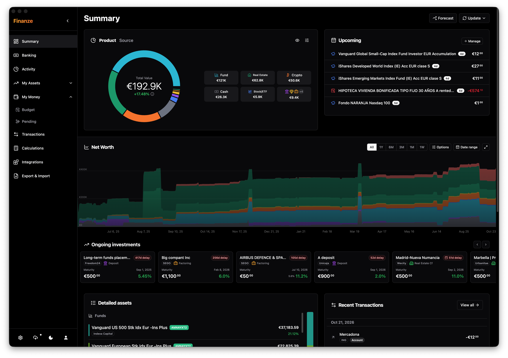
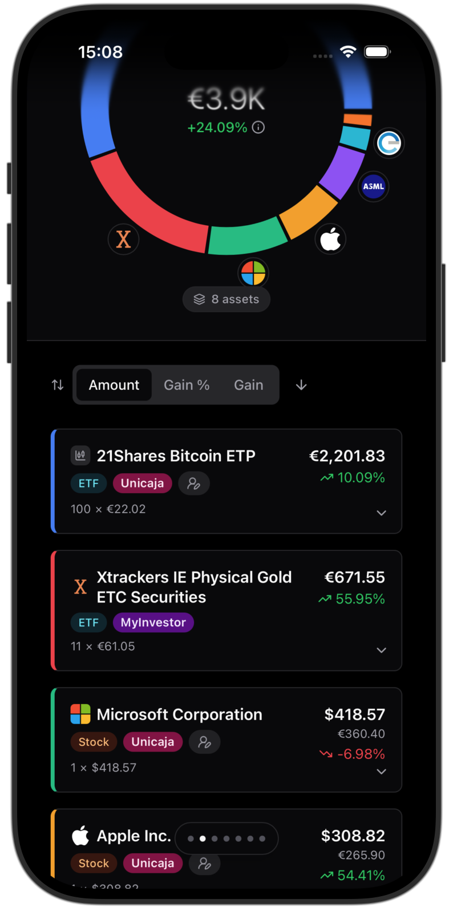
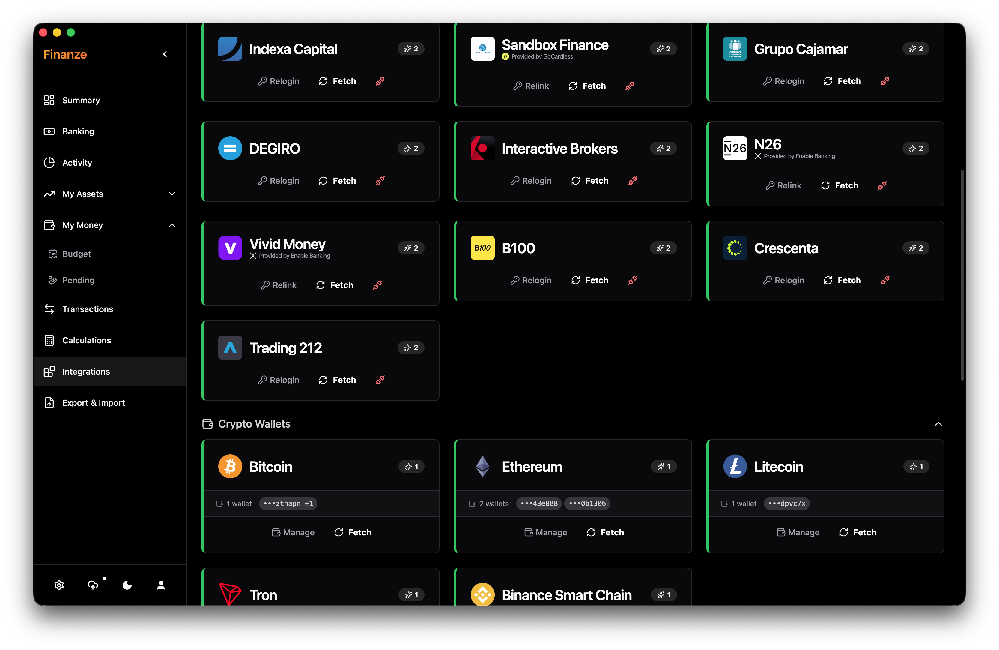
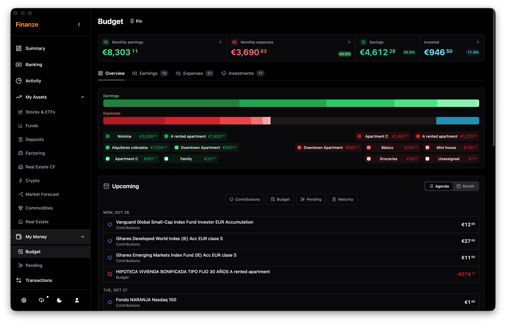
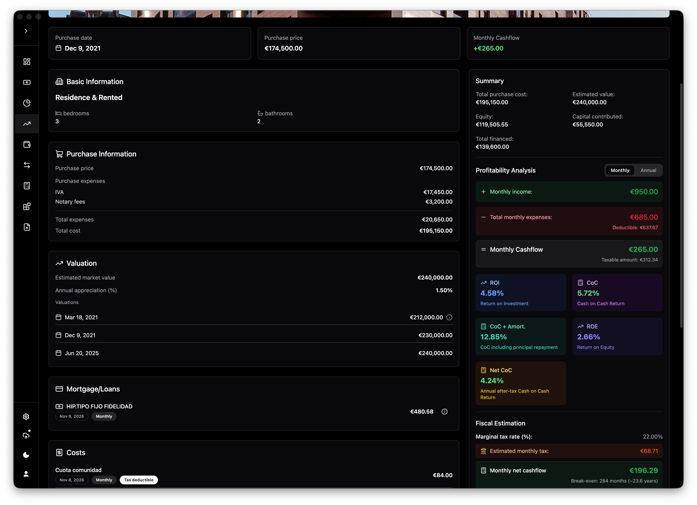
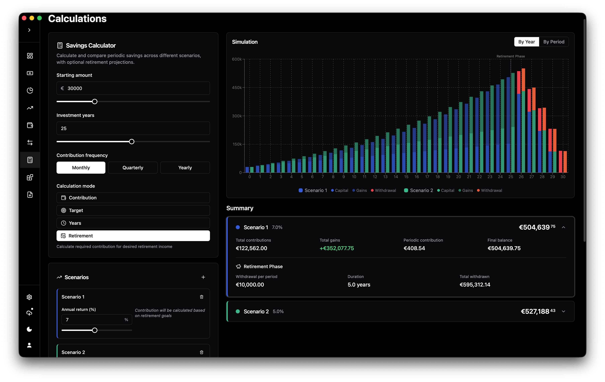
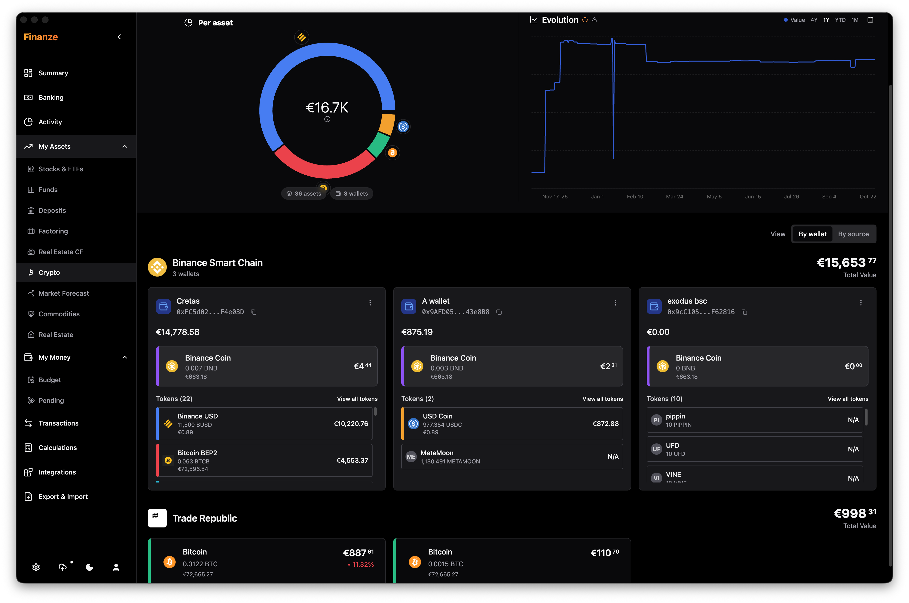
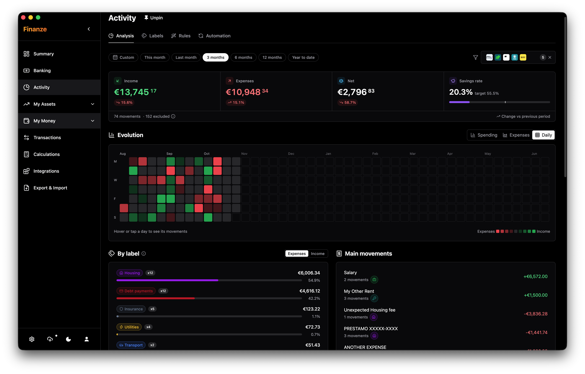

<div align="center">

[English](../README.md) · **Deutsch** · [Português](README.pt.md) · [Español](README.es.md) · [Italiano](README.it.md) · [Français](README.fr.md)

</div>

<p align="center">
  <a href="https://github.com/finanze/finanze/releases/latest"></a>
</p>

<p align="center"></p>
<h1 align="center">Finanze – Selbstgehostete Finanz- und Vermögensverwaltung</h1>

<p align="center">
<a href="https://finanze.me">Finanze</a> ist eine private, selbstgehostete Open-Source-Anwendung zur Verwaltung persönlicher Finanzen und Anlageportfolios. Sie führt Vermögenswerte und Anlagen aus Banken, von Brokern, Crowdfunding-Plattformen, Krypto-Börsen und Wallets sowie Immobilien in einer Anwendung zusammen.
Sie verbindet sich über öffentliche Schnittstellen und Open Banking (PSD2) mit Finanzinstituten, unterstützt verschiedene Anlageklassen (Immobilien, Kryptowährungen, Fonds, Aktien, Rohstoffe usw.) und speichert alle Daten in einer lokal verschlüsselten Datenbank.
</p>

<h3 align="center">Verfügbar für</h3>

<table align="center">
  <tr>
    <td align="center" width="30%"><b>🖥️ Desktop</b></td>
    <td align="center" width="30%"><b>📱 Android</b></td>
    <td align="center" width="40%"><b>🍎 iOS</b></td>
  </tr>
  <tr>
    <td align="center">
      Neueste Version<br>
      <a href="https://github.com/finanze/finanze/releases/latest">Hier herunterladen</a>
    </td>
    <td align="center">
      Bei <br>
      <a href="https://finanze.en.uptodown.com/android" title="Finanze herunterladen"> Uptodown</a>
      <br>
      <b>oder </b><a href="https://github.com/finanze/finanze/releases/latest">.apk herunterladen</a>
    </td>
    <td align="center">
      <a href="https://altstore.io/download"> AltStore</a> installieren und anschließend <a href="https://addaltstore.finanze.me">die App hinzufügen</a><br>
      <b>oder </b><a href="https://testflight.finanze.me">TestFlight</a> beitreten<br>
      <b>oder </b><a href="https://apps.apple.com/es/app/finanze-portfolio-tracker/id6763042710"></a>*
    </td>
  </tr>
</table>

<h2 align="center"></h2>

<p align="middle">
  
  
  
  
  
  
  
  
</p>

## Inhaltsverzeichnis

- [Funktionen](#features)
- [Nutzung](#usage)
- [Entwicklung](#development)
- [Mitwirkende und Danksagungen](#credits)

<a id="features"></a>
## Funktionen

- 🔄 Finanzdaten von mehreren Instituten abrufen
- 💼 Unterstützung verschiedener Finanzprodukte:
    - 📈 Aktien, Fonds, Portfolios, Konten, Immobilien-Crowdfunding, Kryptowährungen usw. aus echten Quellen oder importiert
    - 🏠 Immobilieninvestitionen mit verschiedenen Kennzahlen und KPIs
    - 🪙 Rohstoffe mit Marktwertverfolgung
- 💵 Einnahmen und Ausgaben sowie regelmäßige Anlagebeiträge erfassen, um künftige Vermögensstände zu prognostizieren
- 📊 Monatsbudgets für Bedürfnisse, Wünsche und Investitionen mit verfügbarem Restbetrag und Ausgabenübersicht nach Label
- 🤖 KI-gestützte Transaktionszuordnung mit eigenen Regeln und Modellvorschlägen von Cloud-, selbstgehosteten oder lokalen KI-Anbietern
- 🧠 KI-Import von Dateien: Positionen und Transaktionen aus Abrechnungen, PDFs und Bildern extrahieren
- 💱 Mehrere Währungen mit automatischem Abruf von Wechselkursen
- 🔐 Lokal verschlüsselte Datenbank für sichere Datenspeicherung
- 🤖 MCP-Server für KI-Clients
- 📤 Dynamischer, anpassbarer Export nach Google Sheets, CSV, TSV und Excel
- 📥 Import aus CSV, TSV, Excel, HTML und PDF mit automatischer Spaltenerkennung sowie aus Google Sheets
- ⚙️ Umfangreiche Konfiguration mit Vorlagen für den Import und Export
- 📊 Komplexer Spar- und Altersvorsorgerechner mit mehreren Szenarien und Variablen

### Monatsbudgets

Lege monatliche Ziele für Bedürfnisse, Wünsche und Investitionsbeiträge fest und vergleiche sie mit den tatsächlichen Einnahmen und Ausgaben. Sieh verfügbare oder überschrittene Beträge, verfolge das verbleibende Einkommen im Zeitverlauf und werte Ausgaben nach Label aus.

### Transaktionslabels, Regeln und KI

Erstelle Labels und Regeln, um Transaktionen zu kategorisieren. Regeln können Transaktionstext, Typ, Betrag, Währung, Datum, Institut oder IBAN berücksichtigen. Prüfe Treffer vor dem Anwenden der Regeln – auch auf bestehende Transaktionen. KI-Anbieter können Labels vorschlagen; entscheidungsfähige Modelle können, sofern unterstützt, Konfidenzwerte zurückgeben.

### KI-Anbieter

KI unterstützt die Transaktionszuordnung und den Dateiimport. Verbinde OpenAI (API-Schlüssel), ChatGPT (Plus- oder Pro-Abo), OpenRouter, GitHub Copilot, Anthropic Claude über Claude Code, einen benutzerdefinierten OpenAI-kompatiblen Endpunkt oder lokale Modelle unter **Entities > Providers > AI providers**. GitHub Copilot und Claude Code sind in Desktop- und selbstgehosteten Distributionen verfügbar.

### Lokale und selbstgehostete Modelle

- **Lokale Modelle:** Führe GGUF-Modelle mit der integrierten llama.cpp-Engine auf dem Desktop aus. Lade empfohlene oder Hugging-Face-Modelle herunter, importiere eine GGUF-Datei oder verbinde deinen eigenen llama.cpp-Server im Router-Modus. Modelle mit einem Vision-Projektor (`mmproj`) können Bilder und gescannte PDFs lesen.
- **Eigene KI:** Verbinde eine OpenAI-kompatible API wie Ollama, LM Studio, vLLM oder einen llama.cpp-Server mit einem einzelnen Modell über dessen Basis-URL und optionalen API-Schlüssel.

Die integrierte Engine führt Modelle auf dem Gerät aus und ist nur für Desktop verfügbar. Externe Endpunkte müssen von Finanze aus erreichbar sein.

### MCP-Server

Finanze enthält einen Model Context Protocol (MCP)-Server, über den kompatible KI-Clients auf unterstützte Finanze-Daten und -Werkzeuge zugreifen können. Öffne in der App **Settings > MCP**, aktiviere den Server, wähle einen Zugriffsmodus und kopiere die Verbindungsinformationen für deinen Client. Schreibgeschützter Zugriff ist standardmäßig aktiviert. Mit Schreibzugriff können unterstützte Werkzeuge Daten erstellen, bearbeiten und löschen, Integrationen verbinden und Daten von Finanzinstituten abrufen.

### Unterstützte Finanzinstitute und Krypto-Börsen

| Finanzinstitut | Konten | Karten | Fonds | Aktien/<br>ETFs | Einlagen | Portfolios | Darlehen/<br>Hypotheken | Krypto | Anleihen | Besonderheiten |
| --------------- | ------ | ----- | ----- | -------------- | ------- | ---------- | --------------------- | ------ | -------- | -------------- |
| Urbanitae | ✅ | - | - | - | - | - | - | - | - | Kreditinvestitionen |
| MyInvestor | ✅ | ✅ | ✅ | ✅ | ✅ | ✅ | Kredite | - | - | |
| SEGO | ✅ | - | - | - | - | - | - | - | - | Factoring |
| Trade Republic | ✅ | - | ✅ | ✅ | - | - | - | ✅ | ❌ | Private Markets |
| Unicaja | ✅ | ✅ | ❌ | ❌ | ❌ | - | ✅ | - | - | |
| Wecity | ✅ | - | - | - | - | - | - | - | - | Investitionen |
| Mintos | ✅ (Smart Cash) | - | - | Einzelaktien und ETFs | - | - | - | ❌ | ❌ | Crowdlending |
| Freedom24 | ✅ | - | - | ✅ | - | - | - | ❌ | - | Ältere strukturierte Anlagen |
| Indexa Capital | ✅ | - | ✅️ | - | - | ✅️ | - | - | - | |
| ING | ✅ | ✅ | ✅️ | ✅ | ❌ | - | ❌ | - | - | |
| Grupo Cajamar | ✅ | ✅ | ❌️ | ❌ | ❌ | - | ✅ | - | - | |
| DEGIRO | ✅ | - | ✅️ | ✅️ | - | - | - | - | - | |
| Interactive Brokers | ✅ | - | ❌ | ✅️ Aktien | - | - | - | - | ❌ | |
| B100 | ✅ | ✅ | - | - | - | - | - | - | - | |
| Crescenta | - | - | ✅ | - | - | - | - | - | - | |
| Trading 212 (Beta) | ✅ | - | - | ✅ | - | - | - | ❌ | - | |

| Krypto-Börse | Krypto | Besonderheiten |
| ------------- | ------ | -------------- |
| Binance | ✅ Spot & Futures | Futures |

#### Enable-Banking-Integration

Damit lassen sich EU-Banken anbinden, die von der App nicht direkt unterstützt werden. Die Kontoinformationen werden über eine PSD2-konforme Verbindung abgerufen. Eine Anleitung zur Einrichtung findest du unter **Settings/Integrations** in der App.

#### GoCardless-Integration

Wenn du bereits ein Konto hast, ist GoCardless eine weitere Möglichkeit. Der Dienst bietet ebenfalls PSD2-konforme Kontoinformationen für viele Banken in der EU und im Vereinigten Königreich.

### Funktionen von Finanzinstituten und Krypto-Börsen

Nicht alle Institute unterstützen dieselben Funktionen. Im Allgemeinen lassen sich die Daten in folgende Kategorien einteilen:

- **Gesamtposition:** aktuelle Finanzposition einschließlich des aktuellen Stands der oben genannten Anlagen; wird von allen Instituten unterstützt.
- **Regelmäßige Beiträge:** automatische, regelmäßige Anlagebeiträge, zum Beispiel in Fonds (MyInvestor) oder Aktien/ETFs (Trade Republic).
- **Transaktionen:** alle konto- und anlagebezogenen Transaktionen, Zinszahlungen, Fonds- und Aktiengeschäfte, Fälligkeiten, Gebühren usw.
- **Anlagehistorie:** fasst frühere Positionen und Transaktionen zu einer Historie vergangener und aktueller Anlagen zusammen (Einlagen sind hier nicht enthalten).

| Finanzinstitut | Gesamtposition | Regelmäßige<br>Beiträge | Transaktionen<br>(anlagebezogen) | Anlage-<br>historie |
| --------------- | -------------- | ---------------------- | -------------------------------- | ------------------ |
| Urbanitae | ✅ | - | ✅ | ✅ |
| MyInvestor | ✅ | ✅ | ✅ | ❌ |
| SEGO | ✅ | - | ✅ | ✅ |
| Trade Republic | ✅ | ✅ | ✅ | - |
| Unicaja | ✅ | ✅ | ❌ | - |
| Wecity | ✅ | - | ✅ | ✅ |
| Mintos | ✅ | - | Einzelaktien und ETFs | ❌ |
| Freedom24 | ✅ | - | ✅ | ❌ |
| Indexa Capital | ✅ | - | ✅ | - |
| ING | ✅ | ✅ | ✅ | - |
| Grupo Cajamar | ✅ | - | ❌ | - |
| DEGIRO | ✅ | ❌ | ✅ | - |
| Interactive Brokers | ✅ | ❌ | ✅⚠️ | - |
| B100 | ✅ | ❌ | ✅ (Zinsen) | - |
| Crescenta | ✅ | - | ✅ | - |
| Trading 212 (Beta) | ✅ | ❌ | ✅ | - |

| Krypto-Börse | Gesamtposition | Regelmäßige<br>Beiträge | Transaktionen<br>(anlagebezogen) | Anlage-<br>historie |
| ------------- | -------------- | ---------------------- | -------------------------------- | ------------------ |
| Binance | ✅ Spot | ❌ | ✅️ | - |

### Hinweise zu Finanzinstituten

Bei einigen Instituten ist für die Anmeldung oder den Datenabruf eine Zwei-Faktor-Authentifizierung (2FA) erforderlich. Dadurch ist eine Aktualisierung im Hintergrund nicht möglich. Das betrifft:

- **SEGO** (E-Mail)
- **Trade Republic** (mobile App oder SMS)
- **Wecity** (SMS)
- Manchmal **MyInvestor** (SMS); gelegentlich ist auch ein CAPTCHA erforderlich
- **DEGIRO** (Bestätigung in der mobilen App)

Wichtige Hinweise:

- **Unicaja**:
    - Kann in der mobilen App gelegentlich fehlschlagen.
    - Wenn du nicht die App verwendest, musst du zum Anmelden die Umgebungsvariable `UNICAJA_ABCK` setzen, da Akamai zur Bot-Abwehr verwendet wird.
- Bei **Mintos** ist Selenium erforderlich, um reCAPTCHA außerhalb der App zu lösen.
- **Trade Republic**, **ING** und **IBKR** funktionieren nur über die App, da die Anmeldung eine Benutzeraktion erfordert.
- Die Zins- und zugehörigen Transaktionen des **Freedom24 D-Account** wurden früher unterstützt, nach deren Entfernung jedoch nicht mehr.

### Kryptowährungen

Krypto ist keine Finanzinstitution, sondern ein Finanzprodukt. Richte zum Hinzufügen einfach eine Wallet ein. Unterstützt werden derzeit:

- **Bitcoin** (xpub wird unterstützt)
- **Ethereum**: ERC20-Token werden ebenfalls unterstützt.
- **Litecoin** (xpub wird unterstützt)
- **Tron**: TRC20-Token werden ebenfalls unterstützt.
- **Binance Smart Chain**: BSC-Token werden ebenfalls unterstützt (erfordert die Einrichtung einer Etherscan-Integration mit API-Schlüssel).

Für Kryptowährungen ist derzeit nur die **Gesamtposition** verfügbar; Transaktionen sind in Arbeit.

Einige Finanzinstitute, beispielsweise Trade Republic, unterstützen ebenfalls Kryptowährungen.

#### Zerion

Zerion wird ebenfalls unterstützt. Mit einem kostenlosen API-Schlüssel kannst du mehrere Krypto-Assets und DeFi verfolgen.

#### Weitere Entitätstypen

Mit der App lassen sich auch Prognosemärkte wie Polymarket verfolgen, darunter Transaktionen, Gewinn und Verlust (PnL) sowie aktuelle und historische Positionen (keine manuell erfassten Daten).

### Rohstoffe

Mit der manuellen Eingabe von Rohstoffen kannst du deren Marktwert verfolgen. Unterstützt werden derzeit:

- **Gold**
- **Silber**
- **Platin**
- **Palladium**

<a id="export-import"></a>
### Import und Export

Positionen und Transaktionen lassen sich auf verschiedene Arten importieren und exportieren:

- **Dateien:** Export nach CSV, TSV und Excel. Import aus CSV, TSV, Excel (XLS/XLSX), HTML-Tabellen und textbasierten PDFs. Spalten werden automatisch erkannt oder manuell beziehungsweise mit einer gespeicherten Vorlage zugeordnet. Vor dem Speichern gibt es eine Vorschau.
- **KI-Import:** Extrahiert Daten ohne Vorlagen aus den oben genannten Dateiformaten, einfachem Text und Bildern (PNG, JPEG, WebP, GIF sowie auf Mobilgeräten HEIC), einschließlich gescannter PDFs. Zusätzliche Anweisungen und Ausweichanbieter werden unterstützt. Für Bilder und gescannte PDFs ist ein bildverarbeitungsfähiges Modell erforderlich. Vor dem Speichern werden die Ergebnisse in einer Vorschau angezeigt.
- **Google Sheets:** Export und Import durch Verbinden eines Google-Kontos unter **Entities > Providers**. Importierte Tabellendaten bilden eine eigene Quelle; bei jedem Import werden die vorherigen Google-Sheets-Daten ersetzt, ohne echte oder manuell erfasste Daten zu beeinflussen.

#### Vorlagen

Vorlagen machen den Import und Export umfangreich anpassbar. Sie legen Tabellenstruktur, Datenformatierung, Filter und weitere Optionen fest. Für Dateiimporte sind Vorlagen optional; für Google-Sheets-Importe definieren sie die Datenstruktur.

Weitere technische Informationen findest du unter [Import und Export](#export-import).

<a id="usage"></a>
## Nutzung

### Download

Lade die neueste App-Version für dein Betriebssystem unter [Releases](https://github.com/finanze/finanze/releases) herunter.

Du möchtest die neuesten Funktionen in Entwicklung ausprobieren? Lade einen Build aus dem fortlaufend aktualisierten [`next`-Pre-Release](https://github.com/finanze/finanze/releases/tag/next) herunter. Er wird bei jedem Push nach `develop` aktualisiert. Diese Builds können instabil sein und sind nicht für den produktiven Einsatz vorgesehen.

### Docker

Es gibt zwei Docker-Images: ein Selenium-Image (`latest-selenium`) und ein schlankeres Standard-Image (`latest`).

Wenn du Mintos nicht verwendest, empfehlen wir `latest`.
Für Mintos ist das erste Image erforderlich, da es Selenium sowie Python- und Betriebssystemabhängigkeiten für die reCAPTCHA-Lösung enthält (zum Beispiel ffmpeg).

Beide Images sind auf Docker Hub unter [finanze/finanze](https://hub.docker.com/r/finanze/finanze) verfügbar.

Das Frontend gibt es unter [finanze/finanze-frontend](https://hub.docker.com/r/finanze/finanze-frontend).

Eine vollständige Einrichtung findest du in der Beispieldatei [docker-compose.yml](../docker-compose.yml).

<a id="development"></a>
## Entwicklung

Dieses Projekt benötigt `Python 3.14`.
Für das Frontend werden `pnpm` und `Node 24` verwendet.

### Einrichtung

1. Repository klonen:

    ```sh
    git clone https://github.com/finanze/finanze.git
    cd finanze
    ```

2. Virtuelle Umgebung erstellen und aktivieren (Pyenv wird zur Verwaltung der Python-Versionen empfohlen):

    ```sh
    python3 -m venv venv
    source venv/bin/activate
    ```

3. Benötigte Abhängigkeiten installieren:

    ```sh
    pip install -r requirements.txt -r requirements-dev.txt -r requirements-lint.txt -r requirements-packaging.txt
    pip install -r requirements-selenium.txt  # If you want to use Selenium for reCAPTCHA, only for Mintos
    pre-commit install
    ```

4. Frontend einrichten:

    ```sh
    cd frontend/app
    pnpm install
                         # ---- Mobile SPECIFIC ----
    pnpm install:pyodide # For mobile app initial setup, it will download Pyodide and all required Python dependencies for mobile backend
    ```

5. App starten:

    ```sh
    python ./finanze/finanze --port 7592 --data-dir .storage --log-dir .storage/logs --log-level DEBUG --third-party-log-level DEBUG

    cd frontend/app
    pnpm dev            # For electron desktop app

                        # ---- Mobile SPECIFIC ----
    pnpm dev:mobile     # For mobile app (web feature limited, but useful for basic development and testing)
    pnpm cap:ios        # For iOS development (requires Xcode and Mac)
    pnpm cap:android    # For Android development (requires Android Studio and related SDKs
    pnpm cap:sync       # To sync changes to native projects after frontend development

                        # ---- App Store SPECIFIC ----
    pnpm cap:sync:store # Same as above but this excludes all non App/Play Store compliant stuff (entity connections)
    ```

#### Zusätzlicher Schritt für Mobilgeräte

6. TLS-Client für Mobilgeräte (für einige Institute erforderlich, die TLS-Fingerprint-Impersonation benötigen):

    Erforderlich: Go, vollständiges Xcode mit iOS- und Simulator-SDKs (iOS), JDK 21+ und Android NDK r28+ (Android), gomobile (`go install golang.org/x/mobile/cmd/gomobile@latest && go install golang.org/x/mobile/cmd/gobind@latest`).

    ```sh
    cd frontend/app           # If not already
    go mod tidy -C native/tlsclient
    pnpm native:setup         # Builds iOS xcframework + Android AAR and copies to native projects
    # Or build only the platform you need:
    pnpm native:setup:ios
    pnpm native:setup:android
    ```

    <details>
    <summary>Android- und iOS-Toolchain einrichten</summary>

    **Android:** Installiere **NDK (Side by side)** unter Android Studio > SDK Manager > SDK Tools.
    Der native Build wählt automatisch die neueste vollständige NDK-Installation im SDK-Verzeichnis `ndk/` aus.
    Die Suche verwendet `ANDROID_HOME`, dann `ANDROID_SDK_ROOT` und andernfalls den Standardspeicherort
    (`~/Library/Android/sdk` unter macOS, `~/Android/Sdk` unter Linux).
    Mit `ANDROID_NDK_HOME` (oder `ANDROID_NDK_ROOT`) kannst du die Erkennung überschreiben; ein ungültiger Pfad führt zu einem Fehler und nicht zu einem Fallback.
    Setze `JAVA_HOME` auf ein JDK, nicht auf eine JRE. Ist die Variable nicht gesetzt, gibt der native Build eine Warnung aus und prüft die Java-Tools in `PATH`.

    ```sh
    # macOS: select an installed JDK 21
    export JAVA_HOME="$(/usr/libexec/java_home -v 21)"
    # Only needed for custom SDK/NDK locations or to pin an NDK version:
    export ANDROID_HOME="$HOME/Library/Android/sdk"
    export ANDROID_NDK_HOME="$ANDROID_HOME/ndk/<installed-version>"
    ```

    Ersetze `<installed-version>` durch den Namen des installierten NDK-Verzeichnisses. Füge benötigte Exporte zu deinem Shell-Profil
    (zum Beispiel `~/.zshrc`) hinzu, damit sie in neuen Terminals erhalten bleiben.

    **iOS (macOS):** Die Command Line Tools allein reichen nicht aus. Installiere und öffne Xcode, um die Ersteinrichtung abzuschließen
    und die iOS-Plattformkomponenten zu installieren. Zeigt `xcode-select -p` auf `/Library/Developer/CommandLineTools`
    oder eine andere Xcode-Installation, überschreibe das Entwicklerverzeichnis für den Setup-Befehl:

    ```sh
    DEVELOPER_DIR="/Applications/Xcode.app/Contents/Developer" pnpm native:setup:ios
    ```

    Passe den Pfad an, falls Xcode an einem anderen Ort installiert ist. Um Xcode dauerhaft für zukünftige Befehle auszuwählen:
    `sudo xcode-select --switch /Applications/Xcode.app/Contents/Developer`.
    Vor dem Build prüft der native Build beide iOS-SDKs und erklärt, wie `DEVELOPER_DIR` gesetzt wird, falls ein SDK fehlt.

    </details>

#### Sonstiges

##### Formatierung

    ```sh
    ruff format

    cd frontend/app
    pnpm format
    ```

##### Tests ausführen

    ```sh
    pytest              # Backend

    cd frontend/app
    pnpm test           # Frontend

    cd e2e/standard
    pnpm test           # Web based E2E

    cd e2e/mobile
    pnpm local:both     # Mobile based basic E2E
    ```

### Umgebungsvariablen

In der Beispieldatei docker-compose.yml findest du Umgebungsvariablen, mit denen sich die Standardkonfiguration überschreiben lässt. Die wichtigsten sind:

- `USERNAME` und `PASSWORD` sind optional und starten beim Laden automatisch eine Sitzung.
- `MULTI_USER` ist optional und erlaubt mehreren Nutzern die Registrierung (nur für die lokale Entwicklung empfohlen).
- Weitere Variablen beziehen sich auf Selenium.

<a id="credits"></a>
## Mitwirkende und Danksagungen

- Daten von [CoinGecko](https://www.coingecko.com/).
- Daten von [CoinMarketCap](https://coinmarketcap.com/).
- Daten von [CryptoCompare](https://www.cryptocompare.com/).
- [Pyodide](https://github.com/pyodide/pyodide) ermöglicht die Backend-Kompatibilität für Mobilgeräte.
- Das Llama.cpp-Symbol stammt aus [ggml-org/llama.brand](https://github.com/ggml-org/llama.brand) und wird gemäß der [Markenrichtlinie](https://github.com/ggml-org/llama.brand/blob/master/BRAND-USAGE.md) verwendet (CC BY-NC 4.0).
- Der Trade-Republic-Client basiert auf dem Projekt [pytr-org/pytr](https://github.com/pytr-org/pytr). Die Bibliothek wurde stark angepasst und war für die Integration des Finanzinstituts entscheidend.
- Die Selenium-basierte reCAPTCHA-Lösung beruht auf dem Projekt [sarperavci/GoogleRecaptchaBypass](https://github.com/sarperavci/GoogleRecaptchaBypass/tree/selenium) und verwendet eine leicht veränderte Selenium-Version. Ein Playwright-Port ist [hier](../finanze/infrastructure/client/entity/financial/mintos/recaptcha_solver_playwright.py) verfügbar; im Headless-Modus gibt es jedoch noch Probleme.

---

<small>* Die App-Store-Version hat einen eingeschränkten Funktionsumfang und unterstützt keine Bankverbindungen. Für den vollen Funktionsumfang nutze AltStore oder TestFlight.</small>
