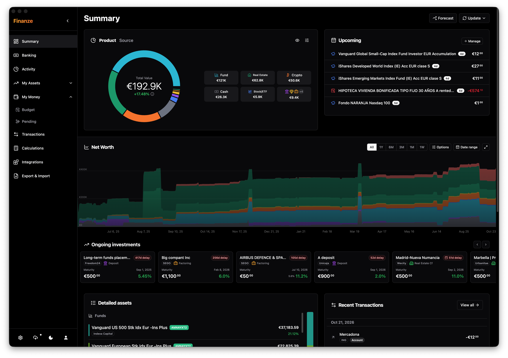
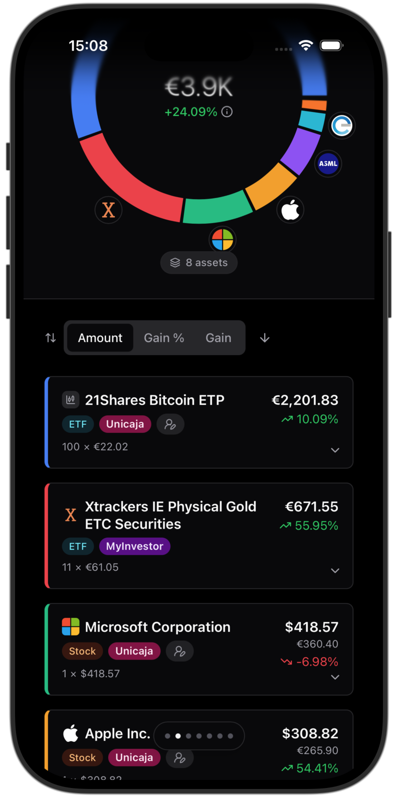
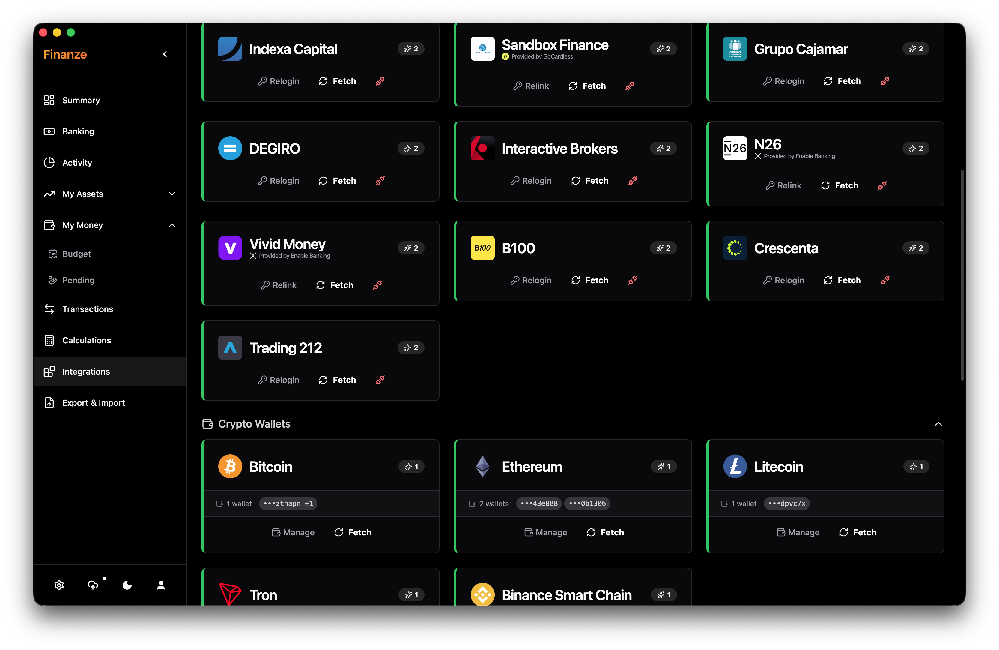
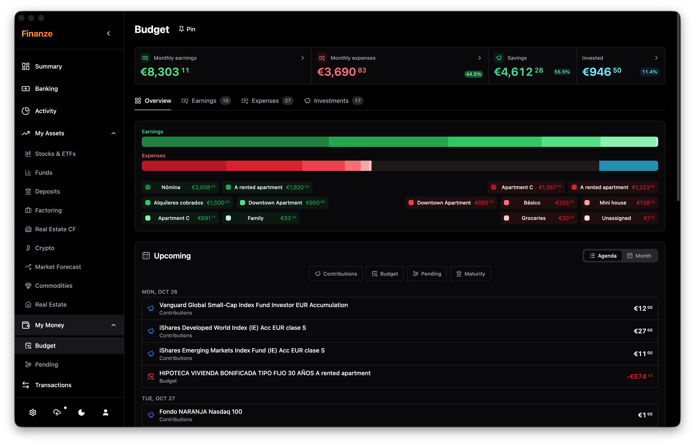
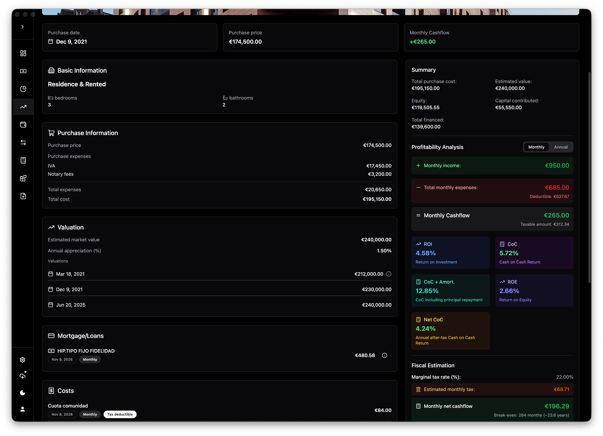
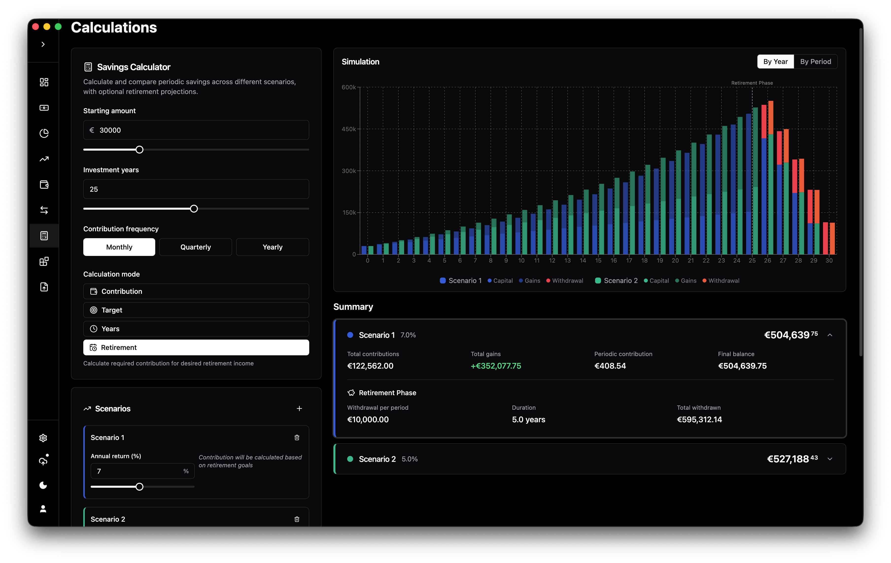
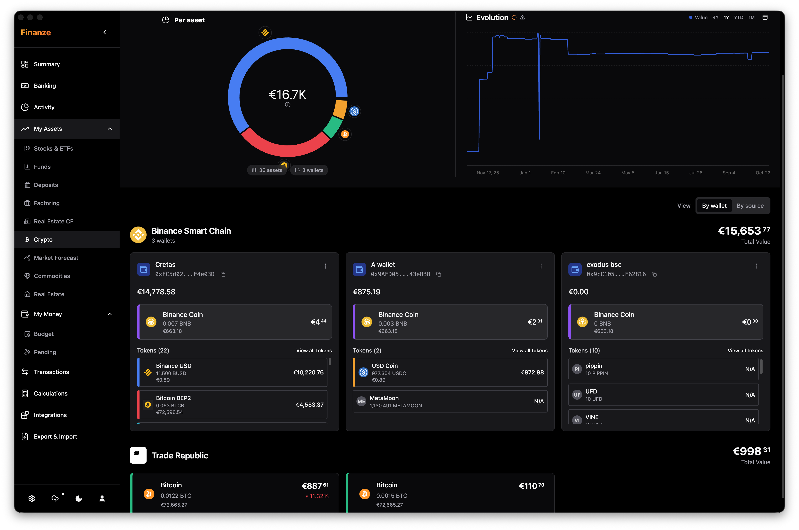
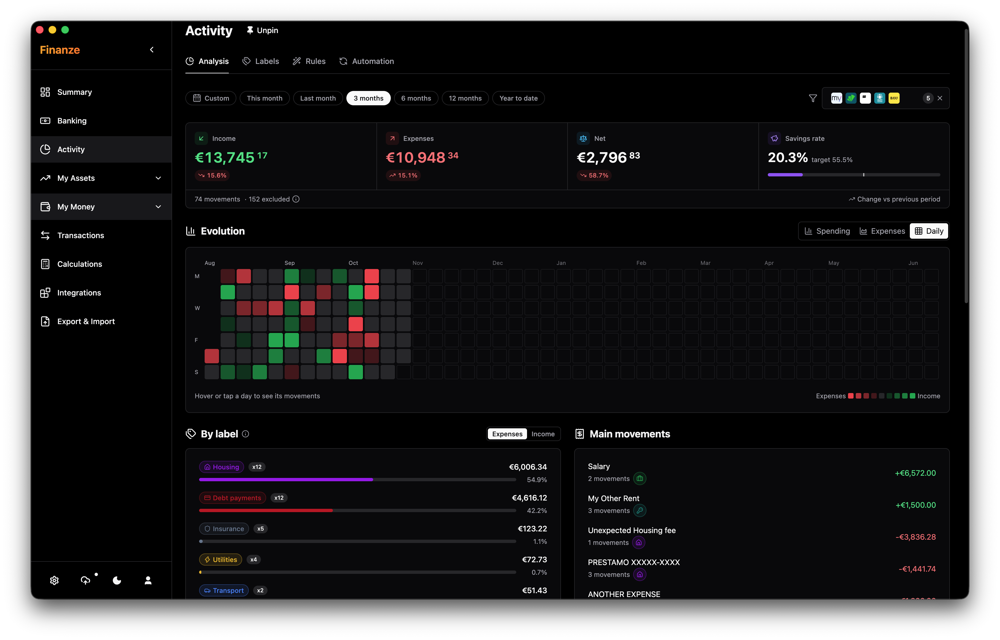

<div align="center">

[English](../README.md) · [Deutsch](README.de.md) · [Português](README.pt.md) · **Español** · [Italiano](README.it.md) · [Français](README.fr.md)

</div>

<p align="center">
  <a href="https://github.com/finanze/finanze/releases/latest"></a>
</p>

<p align="center"></p>
<h1 align="center">Finanze — Gestor local de finanzas personales y patrimonio</h1>

<p align="center">
<a href="https://finanze.me">Finanze</a> es una aplicación privada, local y de código abierto para gestionar las finanzas personales y las carteras de inversión. Reúne en una sola aplicación los activos e inversiones de bancos, brókeres, plataformas de crowdfunding, exchanges y monederos de criptomonedas, e inmuebles.
Se conecta con entidades financieras reales mediante vías públicas y banca abierta (PSD2), admite distintos tipos de activos (inmuebles, criptomonedas, fondos, acciones, materias primas...) y guarda todos los datos en una base de datos local cifrada.
</p>

<h3 align="center">Disponible en</h3>

<table align="center">
  <tr>
    <td align="center" width="30%"><b>🖥️ Escritorio</b></td>
    <td align="center" width="30%"><b>📱 Android</b></td>
    <td align="center" width="40%"><b>🍎 iOS</b></td>
  </tr>
  <tr>
    <td align="center">
      Última versión<br>
      <a href="https://github.com/finanze/finanze/releases/latest">Descargar aquí</a>
    </td>
    <td align="center">
      Descárgala en <br>
      <a href="https://finanze.en.uptodown.com/android" title="Descargar Finanze"> Uptodown</a>
      <br>
      <b>o </b><a href="https://github.com/finanze/finanze/releases/latest">descarga el .apk</a>
    </td>
    <td align="center">
      Instala <a href="https://altstore.io/download"> AltStore</a> y, después, <a href="https://addaltstore.finanze.me">añade la aplicación</a><br>
      <b>o </b>únete a <a href="https://testflight.finanze.me">TestFlight</a><br>
      <b>o </b><a href="https://apps.apple.com/es/app/finanze-portfolio-tracker/id6763042710"></a>*
    </td>
  </tr>
</table>

<h2 align="center"></h2>

<p align="middle">
  
  
  
  
  
  
  
  
</p>

## Índice

- [Funciones](#features)
- [Uso](#usage)
- [Desarrollo](#development)
- [Créditos](#credits)

<a id="features"></a>
## Funciones

- 🔄 Obtén datos financieros de varias entidades
- 💼 Compatibilidad con diversos productos financieros:
    - 📈 Acciones, fondos, carteras, cuentas, crowdfunding inmobiliario, criptomonedas, etc., de fuentes reales o importados
    - 🏠 Inversiones inmobiliarias con distintas métricas e indicadores clave (KPI)
    - 🪙 Materias primas con seguimiento del valor de mercado
- 💵 Registro de ingresos, gastos y aportaciones periódicas a activos para prever posiciones futuras
- 📊 Presupuestos mensuales para necesidades, deseos e inversiones, con saldo restante y desglose de gastos por etiqueta
- 🤖 Etiquetado de transacciones asistido por IA, con reglas personalizadas y sugerencias de proveedores de IA en la nube, en servidores propios o en el dispositivo
- 🧠 Importación de archivos con IA para extraer posiciones y transacciones de extractos, PDF e imágenes
- 💱 Compatibilidad con varias divisas y obtención automática de tipos de cambio
- 🔐 Base de datos local cifrada para guardar los datos de forma segura
- 🤖 Servidor MCP para clientes de IA
- 📤 Exportación dinámica y personalizable a Google Sheets, CSV, TSV y Excel
- 📥 Importación de archivos CSV, TSV, Excel, HTML y PDF con detección automática de columnas, además de Google Sheets
- ⚙️ Configuración flexible con plantillas para importar y exportar
- 📊 Calculadora avanzada de ahorro y jubilación con varios escenarios y variables

### Presupuestos mensuales

Define objetivos mensuales para necesidades, deseos y aportaciones a inversiones, y compáralos con los ingresos y gastos reales. Consulta los importes disponibles o excedidos, sigue el saldo restante a lo largo del tiempo y analiza los gastos por etiqueta.

### Etiquetas, reglas e IA para transacciones

Crea etiquetas y reglas para clasificar transacciones. Las reglas pueden coincidir con el texto, tipo, importe, divisa, fechas, entidades o IBAN de una transacción. Previsualiza las coincidencias antes de aplicar las reglas, también a transacciones existentes. Los proveedores de IA pueden sugerir etiquetas y, cuando se admita, los modelos capaces de tomar decisiones pueden devolver niveles de confianza.

### Proveedores de IA

La IA se utiliza para clasificar transacciones e importar archivos. Conéctate a OpenAI (clave de API), ChatGPT (plan Plus o Pro), OpenRouter, GitHub Copilot, Anthropic Claude mediante Claude Code, un endpoint personalizado compatible con OpenAI o modelos locales en **Entities > Providers > AI providers**. GitHub Copilot y Claude Code están disponibles en las versiones de escritorio y en las distribuciones que se ejecutan en un servidor propio.

### Modelos locales y en servidores propios

- **Modelos locales:** Ejecuta modelos GGUF con el motor llama.cpp integrado en el escritorio. Descarga modelos recomendados o de Hugging Face, importa un archivo GGUF o conecta tu propio servidor llama.cpp en modo router. Los modelos con un proyector de visión (`mmproj`) pueden leer imágenes y PDF escaneados.
- **IA personalizada:** Conecta una API compatible con OpenAI, como Ollama, LM Studio, vLLM o un servidor llama.cpp de un solo modelo, mediante su URL base y una clave de API opcional.

El motor integrado ejecuta modelos en el dispositivo y solo está disponible en escritorio. Los endpoints externos deben ser accesibles desde Finanze.

### Servidor MCP

Finanze incluye un servidor Model Context Protocol (MCP) que permite a clientes de IA compatibles acceder a los datos y herramientas admitidos de Finanze. En la aplicación, abre **Settings > MCP** para activar el servidor, elegir un modo de acceso y copiar los datos de conexión para tu cliente. El acceso de solo lectura está activado de forma predeterminada. El acceso de escritura permite que las herramientas admitidas creen, editen y eliminen datos, conecten integraciones y obtengan datos de entidades.

### Activos admitidos por entidad financiera y exchanges de criptomonedas

| Entidad financiera | Cuentas | Tarjetas | Fondos | Acciones/<br>ETF | Depósitos | Carteras | Préstamos/<br>Hipotecas | Cripto | Bonos | Específico |
| ------------------ | ------- | -------- | ------ | --------------- | --------- | -------- | ----------------------- | ------ | ----- | ---------- |
| Urbanitae | ✅ | - | - | - | - | - | - | - | - | Inversiones de préstamo |
| MyInvestor | ✅ | ✅ | ✅ | ✅ | ✅ | ✅ | Créditos | - | - | |
| SEGO | ✅ | - | - | - | - | - | - | - | - | Factoring |
| Trade Republic | ✅ | - | ✅ | ✅ | - | - | - | ✅ | ❌ | Mercados privados |
| Unicaja | ✅ | ✅ | ❌ | ❌ | ❌ | - | ✅ | - | - | |
| Wecity | ✅ | - | - | - | - | - | - | - | - | Inversiones |
| Mintos | ✅ (Smart Cash) | - | - | Acciones y ETF individuales | - | - | - | ❌ | ❌ | Crowdlending |
| Freedom24 | ✅ | - | - | ✅ | - | - | - | ❌ | - | Productos estructurados antiguos |
| Indexa Capital | ✅ | - | ✅️ | - | - | ✅️ | - | - | - | |
| ING | ✅ | ✅ | ✅️ | ✅ | ❌ | - | ❌ | - | - | |
| Grupo Cajamar | ✅ | ✅ | ❌️ | ❌ | ❌ | - | ✅ | - | - | |
| DEGIRO | ✅ | - | ✅️ | ✅️ | - | - | - | - | - | |
| Interactive Brokers | ✅ | - | ❌ | ✅️ Acciones | - | - | - | - | ❌ | |
| B100 | ✅ | ✅ | - | - | - | - | - | - | - | |
| Crescenta | - | - | ✅ | - | - | - | - | - | - | |
| Trading 212 (Beta) | ✅ | - | - | ✅ | - | - | - | ❌ | - | |

| Exchange de criptomonedas | Cripto | Específico |
| ------------------------- | ------ | ---------- |
| Binance | ✅ Spot & Futures | Futures |

#### Integración con Enable Banking

Permite conectar bancos de la UE que la aplicación no admite de forma nativa mediante información bancaria conforme con PSD2.
Las instrucciones de configuración están en la pestaña Settings/Integrations de la aplicación.

#### Integración con GoCardless

Si ya tienes una cuenta, GoCardless es otra opción que también proporciona información bancaria conforme con PSD2 para muchos bancos de la UE y el Reino Unido.

### Funciones de entidades financieras y exchanges de criptomonedas

No todas las entidades admiten las mismas funciones. En general, podemos agrupar los datos en estas categorías:

- **Posición global:** posición financiera actual, incluido el estado actual de los activos indicados anteriormente; está disponible en todas las entidades.
- **Aportaciones periódicas:** aportaciones automáticas periódicas a inversiones, como fondos (MyInvestor) o acciones/ETF (Trade Republic).
- **Transacciones:** transacciones relacionadas con cuentas o inversiones, pagos de intereses, operaciones de fondos o acciones, vencimientos, comisiones...
- **Historial de inversiones:** agrega posiciones anteriores y transacciones para crear un historial de inversiones pasadas y actuales (los depósitos no se incluyen).

| Entidad financiera | Posición global | Aportaciones<br>periódicas | Transacciones<br>(de inversión) | Historial de<br>inversiones |
| ------------------ | --------------- | -------------------------- | -------------------------------- | --------------------------- |
| Urbanitae | ✅ | - | ✅ | ✅ |
| MyInvestor | ✅ | ✅ | ✅ | ❌ |
| SEGO | ✅ | - | ✅ | ✅ |
| Trade Republic | ✅ | ✅ | ✅ | - |
| Unicaja | ✅ | ✅ | ❌ | - |
| Wecity | ✅ | - | ✅ | ✅ |
| Mintos | ✅ | - | Acciones y ETF individuales | ❌ |
| Freedom24 | ✅ | - | ✅ | ❌ |
| Indexa Capital | ✅ | - | ✅ | - |
| ING | ✅ | ✅ | ✅ | - |
| Grupo Cajamar | ✅ | - | ❌ | - |
| DEGIRO | ✅ | ❌ | ✅ | - |
| Interactive Brokers | ✅ | ❌ | ✅⚠️ | - |
| B100 | ✅ | ❌ | ✅ (intereses) | - |
| Crescenta | ✅ | - | ✅ | - |
| Trading 212 (Beta) | ✅ | ❌ | ✅ | - |

| Exchange de criptomonedas | Posición global | Aportaciones<br>periódicas | Transacciones<br>(de inversión) | Historial de<br>inversiones |
| ------------------------- | --------------- | -------------------------- | -------------------------------- | --------------------------- |
| Binance | ✅ Spot | ❌ | ✅️ | - |

### Notas sobre las entidades financieras

Algunas entidades requieren autenticación en dos pasos (2FA) para iniciar sesión u obtener datos, por lo que no es posible actualizarlas en segundo plano. Se aplica a:

- **SEGO** (correo electrónico)
- **Trade Republic** (aplicación móvil o SMS)
- **Wecity** (SMS)
- A veces **MyInvestor** (SMS), que también puede solicitar un CAPTCHA
- **DEGIRO** (confirmación en la aplicación móvil)

Notas importantes:

- **Unicaja**:
    - Puede fallar ocasionalmente en la aplicación móvil.
    - Si no utilizas la aplicación, debes configurar la variable de entorno `UNICAJA_ABCK` para iniciar sesión, ya que usa Akamai para la protección antibots.
- **Mintos** necesita Selenium para resolver reCAPTCHA fuera de la aplicación.
- **Trade Republic**, **ING** e **IBKR** solo funcionan desde la aplicación, ya que requieren la interacción del usuario para iniciar sesión.
- Los intereses de la cuenta D de **Freedom24** y sus transacciones relacionadas se admitían anteriormente, pero dejaron de admitirse tras su eliminación.

### Criptomonedas

Las criptomonedas son un producto financiero, no una entidad financiera. Para añadirlas, solo tienes que configurar un monedero. Actualmente se admiten:

- **Bitcoin** (admite xpub)
- **Ethereum**: también se admiten tokens ERC20.
- **Litecoin** (admite xpub)
- **Tron**: también se admiten tokens TRC20.
- **Binance Smart Chain**: también se admiten tokens BSC (requiere configurar la integración de Etherscan con una clave de API).

Por ahora, la única función disponible para criptomonedas es la **Posición global**; las transacciones están en desarrollo.

Algunas entidades financieras, como Trade Republic, también admiten criptomonedas.

#### Zerion

Zerion también está disponible (con una clave de API gratuita) y permite realizar el seguimiento de varios activos cripto y DeFi.

#### Otros tipos de entidades

La aplicación también puede hacer seguimiento de mercados de predicción como Polymarket, incluidas transacciones, pérdidas y ganancias (PnL) y posiciones actuales e históricas (no datos introducidos manualmente).

### Materias primas

La introducción manual de materias primas permite hacer un seguimiento de su valor de mercado. Actualmente se admiten:

- **Oro**
- **Plata**
- **Platino**
- **Paladio**

<a id="export-import"></a>
### Importación y exportación

Las posiciones y transacciones se pueden importar y exportar de varias formas:

- **Archivos:** exportación a CSV, TSV y Excel. Importación de CSV, TSV, Excel (XLS/XLSX), tablas HTML y PDF basados en texto.
  Las columnas se detectan automáticamente o se pueden asignar manualmente o con una plantilla guardada, con una vista previa antes de guardar.
- **Importación con IA:** extrae datos sin plantillas de los formatos anteriores, texto sin formato e imágenes (PNG, JPEG, WebP, GIF y HEIC en móviles), incluidos PDF escaneados. Admite instrucciones adicionales y proveedores alternativos. Las imágenes y los PDF escaneados requieren un modelo con capacidad de visión. Los resultados se previsualizan antes de guardarlos.
- **Google Sheets:** exporta e importa conectando una cuenta de Google en **Entities > Providers**. Los datos importados de hojas de cálculo son una fuente propia, por lo que cada importación sustituye los datos anteriores de Google Sheets sin afectar a los datos reales o introducidos manualmente.

#### Plantillas

Las plantillas permiten personalizar ampliamente las importaciones y exportaciones: definen la estructura de las tablas, el formato de los datos, los filtros y otras opciones. Son opcionales para importar archivos y definen las importaciones de Google Sheets.

Consulta la [Importación y exportación](#export-import) para obtener más información técnica.

<a id="usage"></a>
## Uso

### Descarga

Descarga la última versión de la aplicación para tu sistema operativo desde [Releases](https://github.com/finanze/finanze/releases).

¿Quieres probar las últimas funciones en desarrollo? Descarga una compilación de la versión continua
[`next` pre-release](https://github.com/finanze/finanze/releases/tag/next), que se actualiza automáticamente en cada push a `develop`. Estas compilaciones pueden ser inestables y no están pensadas para producción.

### Docker

Hay dos imágenes de Docker disponibles: una con Selenium (`latest-selenium`) y otra predeterminada más ligera (`latest`).

Si no utilizas Mintos, se recomienda `latest`.
La primera es necesaria para Mintos, ya que incluye Selenium y las dependencias de Python y del sistema operativo relacionadas con la resolución de reCAPTCHA (como ffmpeg).

Ambas están disponibles en Docker Hub: [finanze/finanze](https://hub.docker.com/r/finanze/finanze).

El frontend está disponible en [finanze/finanze-frontend](https://hub.docker.com/r/finanze/finanze-frontend).

Consulta el ejemplo [docker-compose.yml](../docker-compose.yml) para una configuración completa.

<a id="development"></a>
## Desarrollo

Este proyecto requiere `Python 3.14`.
Para el frontend, utiliza `pnpm` y `Node 24`.

### Configuración

1. Clona el repositorio:

    ```sh
    git clone https://github.com/finanze/finanze.git
    cd finanze
    ```

2. Crea y activa un entorno virtual (se recomienda Pyenv para gestionar las versiones de Python):

    ```sh
    python3 -m venv venv
    source venv/bin/activate
    ```

3. Instala las dependencias necesarias:

    ```sh
    pip install -r requirements.txt -r requirements-dev.txt -r requirements-lint.txt -r requirements-packaging.txt
    pip install -r requirements-selenium.txt  # If you want to use Selenium for reCAPTCHA, only for Mintos
    pre-commit install
    ```

4. Configura el frontend:

    ```sh
    cd frontend/app
    pnpm install
                         # ---- Mobile SPECIFIC ----
    pnpm install:pyodide # For mobile app initial setup, it will download Pyodide and all required Python dependencies for mobile backend
    ```

5. Ejecuta la aplicación:

    ```sh
    python ./finanze/finanze --port 7592 --data-dir .storage --log-dir .storage/logs --log-level DEBUG --third-party-log-level DEBUG

    cd frontend/app
    pnpm dev            # For electron desktop app

                        # ---- Mobile SPECIFIC ----
    pnpm dev:mobile     # For mobile app (web feature limited, but useful for basic development and testing)
    pnpm cap:ios        # For iOS development (requires Xcode and Mac)
    pnpm cap:android    # For Android development (requires Android Studio and related SDKs
    pnpm cap:sync       # To sync changes to native projects after frontend development

                        # ---- App Store SPECIFIC ----
    pnpm cap:sync:store # Same as above but this excludes all non App/Play Store compliant stuff (entity connections)
    ```

#### Paso adicional para móvil

6. Cliente TLS para móvil (necesario para algunas entidades que requieren suplantación de huella TLS):

    Requisitos: Go, Xcode completo con SDK de iOS y del simulador (iOS), JDK 21+ y Android NDK r28+ (Android), gomobile (`go install golang.org/x/mobile/cmd/gomobile@latest && go install golang.org/x/mobile/cmd/gobind@latest`).

    ```sh
    cd frontend/app           # If not already
    go mod tidy -C native/tlsclient
    pnpm native:setup         # Builds iOS xcframework + Android AAR and copies to native projects
    # Or build only the platform you need:
    pnpm native:setup:ios
    pnpm native:setup:android
    ```

    <details>
    <summary>Configuración de herramientas de Android e iOS</summary>

    **Android:** Instala **NDK (Side by side)** en Android Studio > SDK Manager > SDK Tools.
    La compilación nativa selecciona automáticamente la instalación completa más reciente del NDK en el directorio `ndk/` del SDK.
    Busca en `ANDROID_HOME`, luego en `ANDROID_SDK_ROOT` o, en su defecto, en la ubicación predeterminada
    (`~/Library/Android/sdk` en macOS, `~/Android/Sdk` en Linux).
    Configura `ANDROID_NDK_HOME` (o `ANDROID_NDK_ROOT`) para indicar otra ubicación; si es incorrecta, se produce un error en lugar de recurrir a otra ruta.
    Configura `JAVA_HOME` con un JDK, no un JRE. Si no está definida, la compilación nativa muestra una advertencia y comprueba las herramientas Java en `PATH`.

    ```sh
    # macOS: select an installed JDK 21
    export JAVA_HOME="$(/usr/libexec/java_home -v 21)"
    # Only needed for custom SDK/NDK locations or to pin an NDK version:
    export ANDROID_HOME="$HOME/Library/Android/sdk"
    export ANDROID_NDK_HOME="$ANDROID_HOME/ndk/<installed-version>"
    ```

    Sustituye `<installed-version>` por el nombre del directorio del NDK instalado. Añade las exportaciones necesarias al perfil de tu shell
    (por ejemplo, `~/.zshrc`) para conservarlas en futuros terminales.

    **iOS (macOS):** Las Command Line Tools no son suficientes. Instala y abre Xcode para completar la configuración inicial
    e instalar los componentes de la plataforma iOS. Si `xcode-select -p` apunta a `/Library/Developer/CommandLineTools`
    o a otra instalación de Xcode, indica el directorio de desarrollo para el comando de configuración:

    ```sh
    DEVELOPER_DIR="/Applications/Xcode.app/Contents/Developer" pnpm native:setup:ios
    ```

    Ajusta la ruta si Xcode está instalado en otro lugar. Para seleccionarlo en todos los comandos futuros:
    `sudo xcode-select --switch /Applications/Xcode.app/Contents/Developer`.
    La compilación nativa comprueba ambos SDK de iOS antes de compilar e indica cómo configurar `DEVELOPER_DIR` si no están disponibles.

    </details>

#### Otros

##### Formato

    ```sh
    ruff format

    cd frontend/app
    pnpm format
    ```

##### Ejecución de pruebas

    ```sh
    pytest              # Backend

    cd frontend/app
    pnpm test           # Frontend

    cd e2e/standard
    pnpm test           # Web based E2E

    cd e2e/mobile
    pnpm local:both     # Mobile based basic E2E
    ```

### Variables de entorno

Consulta el ejemplo docker-compose.yml para ver las variables de entorno que permiten sustituir la configuración predeterminada. Las más importantes son:

- `USERNAME` y `PASSWORD` son opcionales y permiten iniciar una sesión automáticamente al cargar.
- `MULTI_USER` es opcional y permite que se registren varios usuarios (solo se recomienda para desarrollo local).
- Otras variables relacionadas con Selenium.

<a id="credits"></a>
## Créditos

- Datos proporcionados por [CoinGecko](https://www.coingecko.com/).
- Datos proporcionados por [CoinMarketCap](https://coinmarketcap.com/).
- Datos proporcionados por [CryptoCompare](https://www.cryptocompare.com/).
- [Pyodide](https://github.com/pyodide/pyodide) permite la compatibilidad del backend móvil.
- El icono de Llama.cpp procede de [ggml-org/llama.brand](https://github.com/ggml-org/llama.brand) y se utiliza según su [política de uso de marca](https://github.com/ggml-org/llama.brand/blob/master/BRAND-USAGE.md) (CC BY-NC 4.0).
- El cliente de Trade Republic se basa en el proyecto [pytr-org/pytr](https://github.com/pytr-org/pytr). Aunque se ha modificado ampliamente, esta biblioteca ha sido esencial para la integración de la entidad.
- La resolución de reCAPTCHA con Selenium se basa en el proyecto [sarperavci/GoogleRecaptchaBypass](https://github.com/sarperavci/GoogleRecaptchaBypass/tree/selenium) y utiliza una versión ligeramente modificada de Selenium. Hay una adaptación para Playwright [aquí](../finanze/infrastructure/client/entity/financial/mintos/recaptcha_solver_playwright.py), aunque todavía presenta problemas en modo headless.

---

<small>* La versión del App Store tiene funciones limitadas y no admite conexiones bancarias. Para disfrutar de todas las funciones, usa AltStore o TestFlight.</small>
