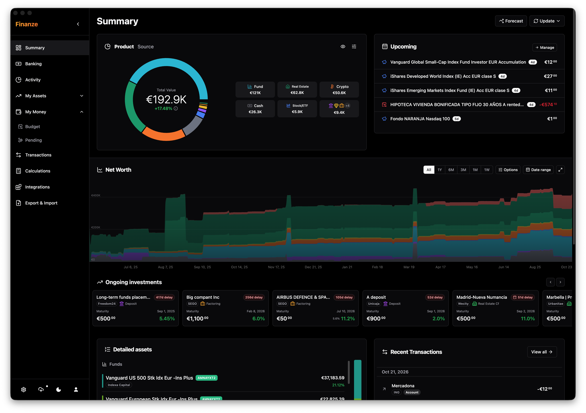
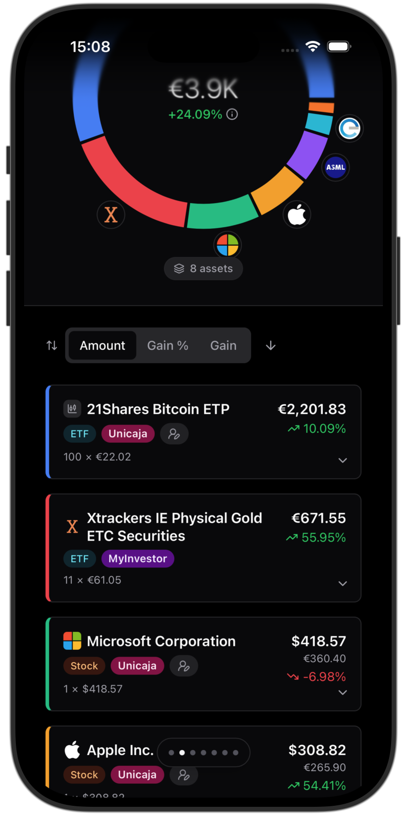
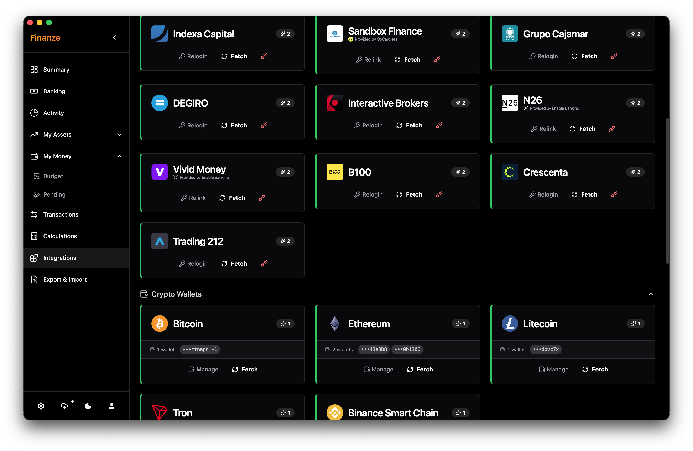
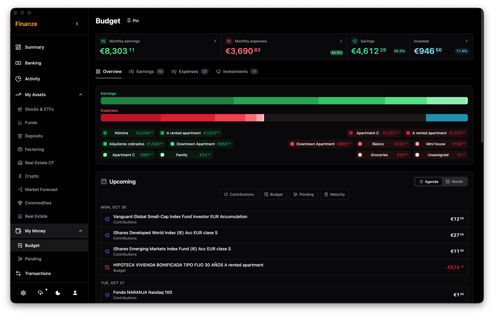
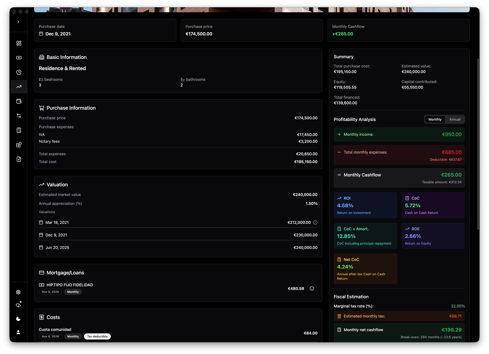
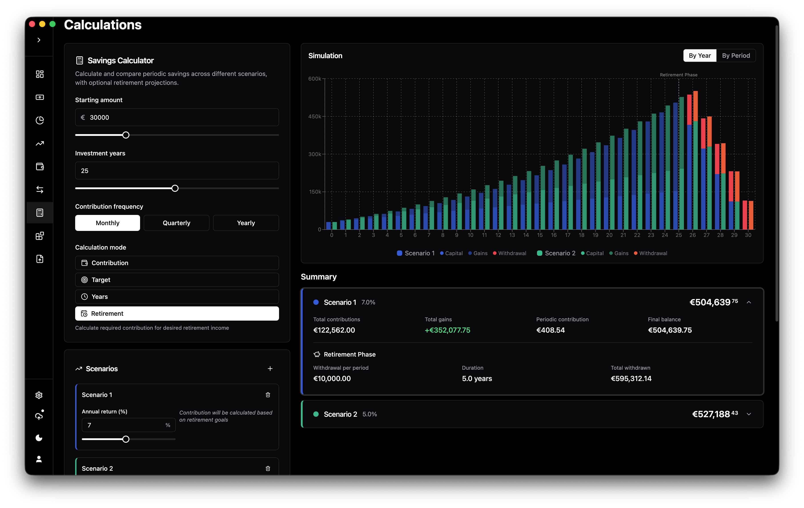
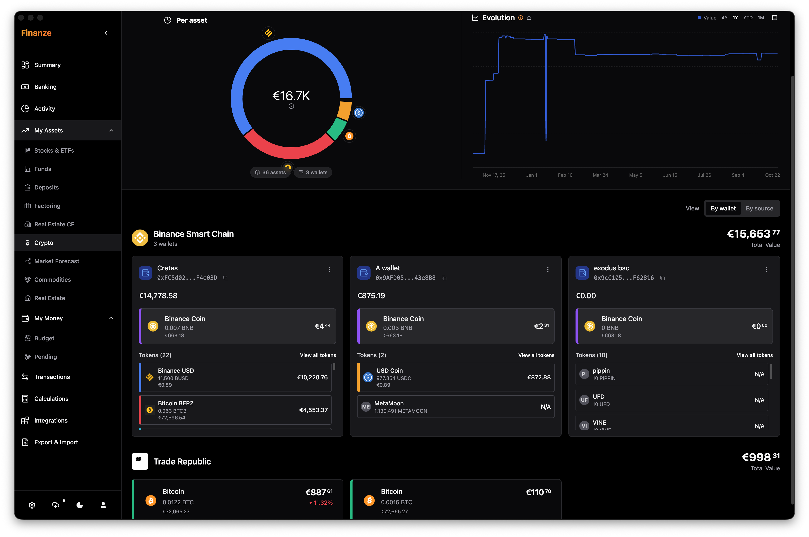
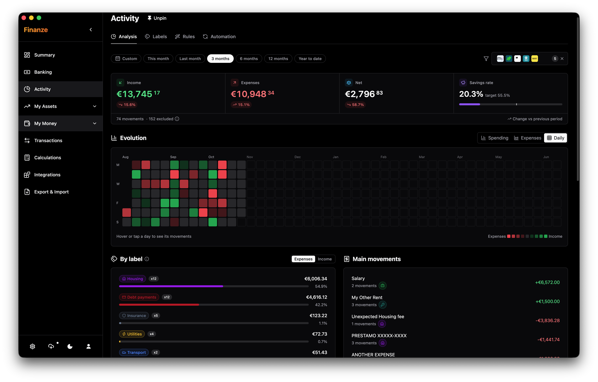

<div align="center">

[English](../README.md) · [Deutsch](README.de.md) · [Português](README.pt.md) · [Español](README.es.md) · [Italiano](README.it.md) · **Français**

</div>

<p align="center">
  <a href="https://github.com/finanze/finanze/releases/latest"></a>
</p>

<p align="center"></p>
<h1 align="center">Finanze — Gestionnaire auto-hébergé de finances personnelles et de patrimoine</h1>

<p align="center">
<a href="https://finanze.me">Finanze</a> est une application privée, auto-hébergée et open source de gestion des finances personnelles et des portefeuilles d’investissement. Elle rassemble dans une seule application les actifs et investissements détenus auprès de banques, courtiers, plateformes de financement participatif, plateformes d’échange et portefeuilles de cryptomonnaies, ainsi que les biens immobiliers.
Elle se connecte aux établissements financiers réels par des moyens publics et via l’open banking (PSD2), prend en charge différents types d’actifs (immobilier, cryptomonnaies, fonds, actions, matières premières...) et stocke toutes les données dans une base de données locale chiffrée.
</p>

<h3 align="center">Disponible sur</h3>

<table align="center">
  <tr>
    <td align="center" width="30%"><b>🖥️ Ordinateur</b></td>
    <td align="center" width="30%"><b>📱 Android</b></td>
    <td align="center" width="40%"><b>🍎 iOS</b></td>
  </tr>
  <tr>
    <td align="center">
      Dernière version<br>
      <a href="https://github.com/finanze/finanze/releases/latest">Télécharger ici</a>
    </td>
    <td align="center">
      Disponible sur <br>
      <a href="https://finanze.en.uptodown.com/android" title="Télécharger Finanze"> Uptodown</a>
      <br>
      <b>ou </b><a href="https://github.com/finanze/finanze/releases/latest">télécharger le .apk</a>
    </td>
    <td align="center">
      Installez <a href="https://altstore.io/download"> AltStore</a>, puis <a href="https://addaltstore.finanze.me">ajoutez l’application</a><br>
      <b>ou </b>rejoignez <a href="https://testflight.finanze.me">TestFlight</a><br>
      <b>ou </b><a href="https://apps.apple.com/es/app/finanze-portfolio-tracker/id6763042710"></a>*
    </td>
  </tr>
</table>

<h2 align="center"></h2>

<p align="middle">
  
  
  
  
  
  
  
  
</p>

## Sommaire

- [Fonctionnalités](#features)
- [Utilisation](#usage)
- [Développement](#development)
- [Crédits](#credits)

<a id="features"></a>
## Fonctionnalités

- 🔄 Récupération des données financières de plusieurs établissements
- 💼 Prise en charge de différents produits financiers :
    - 📈 Actions, fonds, portefeuilles, comptes, financement participatif immobilier, cryptomonnaies, etc., depuis des sources réelles ou par importation
    - 🏠 Investissements immobiliers avec différents indicateurs et KPI
    - 🪙 Matières premières avec suivi de leur valeur de marché
- 💵 Suivi des revenus, dépenses et versements périodiques sur les actifs pour prévoir leur évolution
- 📊 Budgets mensuels pour les besoins, les envies et les investissements, avec solde restant et répartition des dépenses par étiquette
- 🤖 Étiquetage des transactions assisté par l’IA, avec règles personnalisées et suggestions de modèles cloud, auto-hébergés ou exécutés sur l’appareil
- 🧠 Importation de fichiers par IA pour extraire les positions et transactions de relevés, PDF et images
- 💱 Prise en charge de plusieurs devises et récupération automatique des taux de change
- 🔐 Base de données locale chiffrée pour stocker les données en toute sécurité
- 🤖 Serveur MCP pour les clients d’IA
- 📤 Exportation dynamique et personnalisable vers Google Sheets, CSV, TSV et Excel
- 📥 Importation de fichiers CSV, TSV, Excel, HTML et PDF avec détection automatique des colonnes, ainsi que de Google Sheets
- ⚙️ Configuration flexible grâce à des modèles d’importation et d’exportation
- 📊 Calculateur avancé d’épargne et de retraite avec plusieurs scénarios et variables

### Budgets mensuels

Définissez des objectifs mensuels pour les besoins, les envies et les versements d’investissement, puis comparez-les aux revenus et dépenses réels. Consultez les montants disponibles ou dépassés, suivez le solde restant au fil du temps et analysez les dépenses par étiquette.

### Étiquettes, règles et IA pour les transactions

Créez des étiquettes et des règles pour catégoriser les transactions. Les règles peuvent porter sur le texte, le type, le montant, la devise, les dates, les entités ou les IBAN des transactions. Prévisualisez les correspondances avant d’appliquer les règles, y compris aux transactions existantes. Les fournisseurs d’IA peuvent suggérer des étiquettes et, lorsque cela est pris en charge, les modèles capables de prendre des décisions peuvent renvoyer des scores de confiance.

### Fournisseurs d’IA

L’IA sert à étiqueter les transactions et à importer des fichiers. Connectez OpenAI (clé API), ChatGPT (abonnement Plus ou Pro), OpenRouter, GitHub Copilot, Anthropic Claude via Claude Code, un point de terminaison personnalisé compatible avec OpenAI ou des modèles locaux sous **Entities > Providers > AI providers**. GitHub Copilot et Claude Code sont disponibles dans les distributions ordinateur et auto-hébergées.

### Modèles locaux et auto-hébergés

- **Modèles locaux :** Exécutez des modèles GGUF avec le moteur llama.cpp intégré sur ordinateur. Téléchargez des modèles recommandés ou depuis Hugging Face, importez un fichier GGUF ou connectez votre propre serveur llama.cpp en mode routeur. Les modèles dotés d’un projecteur de vision (`mmproj`) peuvent lire des images et des PDF numérisés.
- **IA personnalisée :** Connectez une API compatible avec OpenAI, comme Ollama, LM Studio, vLLM ou un serveur llama.cpp à modèle unique, au moyen de son URL de base et d’une clé API facultative.

Le moteur intégré exécute les modèles sur l’appareil et n’est disponible que sur ordinateur. Les points de terminaison externes doivent être accessibles depuis Finanze.

### Serveur MCP

Finanze comprend un serveur Model Context Protocol (MCP) qui permet aux clients d’IA compatibles d’accéder aux données et outils Finanze pris en charge. Dans l’application, ouvrez **Settings > MCP** pour activer le serveur, choisir un mode d’accès et copier les informations de connexion pour votre client. L’accès en lecture seule est activé par défaut. L’accès en écriture permet aux outils pris en charge de créer, modifier et supprimer des données, de connecter des intégrations et de récupérer les données des entités.

### Actifs pris en charge par établissement financier et plateformes d’échange crypto

| Établissement financier | Comptes | Cartes | Fonds | Actions/<br>ETF | Dépôts | Portefeuilles | Prêts/<br>Hypothèques | Crypto | Obligations | Spécificités |
| ----------------------- | ------- | ------ | ----- | -------------- | ------ | ------------- | -------------------- | ----- | ----------- | ------------ |
| Urbanitae | ✅ | - | - | - | - | - | - | - | - | Investissements de crédit |
| MyInvestor | ✅ | ✅ | ✅ | ✅ | ✅ | ✅ | Crédits | - | - | |
| SEGO | ✅ | - | - | - | - | - | - | - | - | Affacturage |
| Trade Republic | ✅ | - | ✅ | ✅ | - | - | - | ✅ | ❌ | Marchés privés |
| Unicaja | ✅ | ✅ | ❌ | ❌ | ❌ | - | ✅ | - | - | |
| Wecity | ✅ | - | - | - | - | - | - | - | - | Investissements |
| Mintos | ✅ (Smart Cash) | - | - | Actions et ETF individuels | - | - | - | ❌ | ❌ | Crowdlending |
| Freedom24 | ✅ | - | - | ✅ | - | - | - | ❌ | - | Anciens placements structurés |
| Indexa Capital | ✅ | - | ✅️ | - | - | ✅️ | - | - | - | |
| ING | ✅ | ✅ | ✅️ | ✅ | ❌ | - | ❌ | - | - | |
| Grupo Cajamar | ✅ | ✅ | ❌️ | ❌ | ❌ | - | ✅ | - | - | |
| DEGIRO | ✅ | - | ✅️ | ✅️ | - | - | - | - | - | |
| Interactive Brokers | ✅ | - | ❌ | ✅️ Actions | - | - | - | - | ❌ | |
| B100 | ✅ | ✅ | - | - | - | - | - | - | - | |
| Crescenta | - | - | ✅ | - | - | - | - | - | - | |
| Trading 212 (Beta) | ✅ | - | - | ✅ | - | - | - | ❌ | - | |

| Plateforme d’échange crypto | Crypto | Spécificités |
| --------------------------- | ------ | ------------ |
| Binance | ✅ Spot & Futures | Futures |

#### Intégration Enable Banking

Permet de connecter des banques de l’UE qui ne sont pas prises en charge nativement par l’application au moyen d’informations bancaires conformes à la PSD2.
Les instructions de configuration se trouvent dans l’onglet Settings/Integrations de l’application.

#### Intégration GoCardless

Si vous avez déjà un compte, GoCardless constitue une autre option qui fournit également des informations bancaires conformes à la PSD2 pour de nombreuses banques de l’UE et du Royaume-Uni.

### Fonctionnalités des établissements financiers et plateformes d’échange crypto

Les fonctionnalités varient selon les établissements. En général, les données peuvent être regroupées dans les catégories suivantes :

- **Position globale :** position financière actuelle, y compris l’état actuel des actifs mentionnés ci-dessus ; cette fonction est prise en charge par tous les établissements.
- **Versements périodiques :** versements automatiques et périodiques sur des investissements, par exemple des fonds (MyInvestor) ou des actions/ETF (Trade Republic).
- **Transactions :** toutes les transactions liées aux comptes et investissements, paiements d’intérêts, opérations sur actions ou fonds, échéances, frais...
- **Historique des investissements :** agrège les positions passées et les transactions pour créer un historique des investissements passés et actuels (les dépôts ne sont pas inclus).

| Établissement financier | Position globale | Versements<br>périodiques | Transactions<br>(liées aux investissements) | Historique des<br>investissements |
| ----------------------- | ---------------- | ------------------------- | ------------------------------------------ | -------------------------------- |
| Urbanitae | ✅ | - | ✅ | ✅ |
| MyInvestor | ✅ | ✅ | ✅ | ❌ |
| SEGO | ✅ | - | ✅ | ✅ |
| Trade Republic | ✅ | ✅ | ✅ | - |
| Unicaja | ✅ | ✅ | ❌ | - |
| Wecity | ✅ | - | ✅ | ✅ |
| Mintos | ✅ | - | Actions et ETF individuels | ❌ |
| Freedom24 | ✅ | - | ✅ | ❌ |
| Indexa Capital | ✅ | - | ✅ | - |
| ING | ✅ | ✅ | ✅ | - |
| Grupo Cajamar | ✅ | - | ❌ | - |
| DEGIRO | ✅ | ❌ | ✅ | - |
| Interactive Brokers | ✅ | ❌ | ✅⚠️ | - |
| B100 | ✅ | ❌ | ✅ (intérêts) | - |
| Crescenta | ✅ | - | ✅ | - |
| Trading 212 (Beta) | ✅ | ❌ | ✅ | - |

| Plateforme d’échange crypto | Position globale | Versements<br>périodiques | Transactions<br>(liées aux investissements) | Historique des<br>investissements |
| --------------------------- | ---------------- | ------------------------- | ------------------------------------------ | -------------------------------- |
| Binance | ✅ Spot | ❌ | ✅️ | - |

### Remarques sur les établissements financiers

Certains établissements exigent une authentification à deux facteurs (2FA) pour se connecter ou récupérer des données, ce qui empêche les mises à jour en arrière-plan. Cela concerne :

- **SEGO** (e-mail)
- **Trade Republic** (application mobile ou SMS)
- **Wecity** (SMS)
- Parfois **MyInvestor** (SMS), qui peut également demander un CAPTCHA
- **DEGIRO** (confirmation dans l’application mobile)

Remarques importantes :

- **Unicaja** :
    - Peut parfois échouer dans l’application mobile.
    - Si vous n’utilisez pas l’application, vous devez définir la variable d’environnement `UNICAJA_ABCK` pour vous connecter, car Akamai est utilisé pour la protection anti-bot.
- **Mintos** nécessite Selenium pour résoudre reCAPTCHA en dehors de l’application.
- **Trade Republic**, **ING** et **IBKR** ne fonctionnent que via l’application, car la connexion nécessite une action de l’utilisateur.
- Les intérêts du compte D de **Freedom24** et les transactions associées étaient pris en charge, mais ne le sont plus depuis leur suppression.

### Cryptomonnaies

Les cryptomonnaies sont des produits financiers, pas des établissements financiers. Pour les ajouter, il suffit de configurer un portefeuille. Les éléments suivants sont actuellement pris en charge :

- **Bitcoin** (prise en charge des xpub)
- **Ethereum** : les tokens ERC20 sont également pris en charge.
- **Litecoin** (prise en charge des xpub)
- **Tron** : les tokens TRC20 sont également pris en charge.
- **Binance Smart Chain** : les tokens BSC sont également pris en charge (nécessite la configuration d’une intégration Etherscan avec une clé API).

Pour les cryptomonnaies, seule la **Position globale** est actuellement disponible ; les transactions sont en cours de développement.

Certains établissements financiers, comme Trade Republic, prennent également en charge les cryptomonnaies.

#### Zerion

Zerion est également pris en charge (avec une clé API gratuite) et permet de suivre plusieurs actifs crypto et DeFi.

#### Autres types d’entités

L’application permet aussi de suivre des marchés de prédiction comme Polymarket, notamment les transactions, les profits et pertes (PnL) et les positions actuelles et historiques (pas les données saisies manuellement).

### Matières premières

La saisie manuelle des matières premières permet d’en suivre la valeur de marché. Les matières premières suivantes sont actuellement prises en charge :

- **Or**
- **Argent**
- **Platine**
- **Palladium**

<a id="export-import"></a>
### Importation et exportation

Les positions et transactions peuvent être importées et exportées de plusieurs façons :

- **Fichiers :** exportation au format CSV, TSV et Excel. Importation depuis des fichiers CSV, TSV, Excel (XLS/XLSX), des tableaux HTML et des PDF contenant du texte.
  Les colonnes sont détectées automatiquement ou associées manuellement ou à l’aide d’un modèle enregistré ; un aperçu est disponible avant l’enregistrement.
- **Importation par IA :** extrait les données sans modèle depuis les formats de fichiers ci-dessus, du texte brut et des images (PNG, JPEG, WebP, GIF, ainsi que HEIC sur mobile), y compris les PDF numérisés. Prend en charge des instructions supplémentaires et des fournisseurs de secours. Les images et PDF numérisés nécessitent un modèle capable de traiter les images. Les résultats sont prévisualisés avant l’enregistrement.
- **Google Sheets :** exportation et importation en connectant un compte Google sous **Entities > Providers**. Les données importées depuis les feuilles de calcul constituent leur propre source ; chaque importation remplace les anciennes données Google Sheets sans affecter les données réelles ou saisies manuellement.

#### Modèles

Les modèles permettent de personnaliser largement les importations et exportations : ils définissent la structure des tableaux, le formatage des données, les filtres et d’autres options. Ils sont facultatifs pour les importations de fichiers et définissent la structure des importations Google Sheets.

Consultez la [section Importation et exportation](#export-import) pour plus d’informations techniques.

<a id="usage"></a>
## Utilisation

### Téléchargement

Téléchargez la dernière version de l’application pour votre système d’exploitation depuis [Releases](https://github.com/finanze/finanze/releases).

Vous souhaitez essayer les dernières fonctionnalités en cours de développement ? Téléchargez une version du pré-lancement continu
[`next`](https://github.com/finanze/finanze/releases/tag/next), mis à jour automatiquement à chaque push vers `develop`. Ces versions peuvent être instables et ne sont pas destinées à un usage en production.

### Docker

Deux images Docker sont disponibles : une image Selenium (`latest-selenium`) et une image par défaut plus légère (`latest`).

Si vous n’utilisez pas Mintos, `latest` est recommandée.
La première est nécessaire pour Mintos, car elle contient Selenium ainsi que les dépendances Python et système d’exploitation liées à la résolution de reCAPTCHA (comme ffmpeg).

Les deux images sont disponibles sur Docker Hub : [finanze/finanze](https://hub.docker.com/r/finanze/finanze).

Le frontend est disponible sur [finanze/finanze-frontend](https://hub.docker.com/r/finanze/finanze-frontend).

Consultez l’exemple [docker-compose.yml](../docker-compose.yml) pour obtenir une configuration complète.

<a id="development"></a>
## Développement

Ce projet nécessite `Python 3.14`.
Pour le frontend, utilisez `pnpm` et `Node 24`.

### Configuration

1. Clonez le dépôt :

    ```sh
    git clone https://github.com/finanze/finanze.git
    cd finanze
    ```

2. Créez et activez un environnement virtuel (Pyenv est recommandé pour gérer les versions de Python) :

    ```sh
    python3 -m venv venv
    source venv/bin/activate
    ```

3. Installez les dépendances requises :

    ```sh
    pip install -r requirements.txt -r requirements-dev.txt -r requirements-lint.txt -r requirements-packaging.txt
    pip install -r requirements-selenium.txt  # If you want to use Selenium for reCAPTCHA, only for Mintos
    pre-commit install
    ```

4. Configurez le frontend :

    ```sh
    cd frontend/app
    pnpm install
                         # ---- Mobile SPECIFIC ----
    pnpm install:pyodide # For mobile app initial setup, it will download Pyodide and all required Python dependencies for mobile backend
    ```

5. Lancez l’application :

    ```sh
    python ./finanze/finanze --port 7592 --data-dir .storage --log-dir .storage/logs --log-level DEBUG --third-party-log-level DEBUG

    cd frontend/app
    pnpm dev            # For electron desktop app

                        # ---- Mobile SPECIFIC ----
    pnpm dev:mobile     # For mobile app (web feature limited, but useful for basic development and testing)
    pnpm cap:ios        # For iOS development (requires Xcode and Mac)
    pnpm cap:android    # For Android development (requires Android Studio and related SDKs
    pnpm cap:sync       # To sync changes to native projects after frontend development

                        # ---- App Store SPECIFIC ----
    pnpm cap:sync:store # Same as above but this excludes all non App/Play Store compliant stuff (entity connections)
    ```

#### Étape supplémentaire pour mobile

6. Client TLS pour mobile (requis par certaines entités nécessitant l’usurpation de l’empreinte TLS) :

    Prérequis : Go, Xcode complet avec les SDK iOS et simulateur (iOS), JDK 21+ et Android NDK r28+ (Android), gomobile (`go install golang.org/x/mobile/cmd/gomobile@latest && go install golang.org/x/mobile/cmd/gobind@latest`).

    ```sh
    cd frontend/app           # If not already
    go mod tidy -C native/tlsclient
    pnpm native:setup         # Builds iOS xcframework + Android AAR and copies to native projects
    # Or build only the platform you need:
    pnpm native:setup:ios
    pnpm native:setup:android
    ```

    <details>
    <summary>Configuration des chaînes d’outils Android et iOS</summary>

    **Android :** Installez le **NDK (Side by side)** dans Android Studio > SDK Manager > SDK Tools.
    La compilation native sélectionne automatiquement la dernière installation complète du NDK dans le répertoire `ndk/` du SDK.
    Elle recherche d’abord dans `ANDROID_HOME`, puis dans `ANDROID_SDK_ROOT` ou, à défaut, dans l’emplacement par défaut
    (`~/Library/Android/sdk` sur macOS, `~/Android/Sdk` sur Linux).
    Définissez `ANDROID_NDK_HOME` (ou `ANDROID_NDK_ROOT`) pour remplacer cette détection ; un chemin non valide provoque une erreur au lieu d’un repli.
    Définissez `JAVA_HOME` vers un JDK, et non vers un JRE. Si la variable n’est pas définie, la compilation native affiche un avertissement et vérifie la présence des outils Java dans `PATH`.

    ```sh
    # macOS: select an installed JDK 21
    export JAVA_HOME="$(/usr/libexec/java_home -v 21)"
    # Only needed for custom SDK/NDK locations or to pin an NDK version:
    export ANDROID_HOME="$HOME/Library/Android/sdk"
    export ANDROID_NDK_HOME="$ANDROID_HOME/ndk/<installed-version>"
    ```

    Remplacez `<installed-version>` par le nom du dossier du NDK installé. Ajoutez les exports nécessaires à votre profil shell
    (par exemple `~/.zshrc`) pour les conserver dans les prochains terminaux.

    **iOS (macOS) :** Les outils en ligne de commande seuls ne suffisent pas. Installez et ouvrez Xcode pour terminer la configuration initiale
    et installer les composants de la plateforme iOS. Si `xcode-select -p` pointe vers `/Library/Developer/CommandLineTools`
    ou vers une autre installation de Xcode, indiquez le répertoire de développement pour la commande de configuration :

    ```sh
    DEVELOPER_DIR="/Applications/Xcode.app/Contents/Developer" pnpm native:setup:ios
    ```

    Modifiez le chemin si Xcode est installé ailleurs. Pour sélectionner cette installation dans les commandes suivantes :
    `sudo xcode-select --switch /Applications/Xcode.app/Contents/Developer`.
    Avant la compilation, le processus vérifie la présence des deux SDK iOS et indique comment définir `DEVELOPER_DIR` si nécessaire.

    </details>

#### Autres

##### Formatage

    ```sh
    ruff format

    cd frontend/app
    pnpm format
    ```

##### Exécution des tests

    ```sh
    pytest              # Backend

    cd frontend/app
    pnpm test           # Frontend

    cd e2e/standard
    pnpm test           # Web based E2E

    cd e2e/mobile
    pnpm local:both     # Mobile based basic E2E
    ```

### Variables d’environnement

Consultez l’exemple docker-compose.yml pour connaître les variables d’environnement qui peuvent remplacer la configuration par défaut. Les plus importantes sont :

- `USERNAME` et `PASSWORD` sont facultatives et permettent de démarrer automatiquement une session au chargement.
- `MULTI_USER` est facultative et permet à plusieurs utilisateurs de s’inscrire (recommandé uniquement pour le développement local).
- D’autres variables concernent Selenium.

<a id="credits"></a>
## Crédits

- Données fournies par [CoinGecko](https://www.coingecko.com/).
- Données fournies par [CoinMarketCap](https://coinmarketcap.com/).
- Données fournies par [CryptoCompare](https://www.cryptocompare.com/).
- [Pyodide](https://github.com/pyodide/pyodide) est utilisé pour la compatibilité du backend mobile.
- L’icône Llama.cpp provient de [ggml-org/llama.brand](https://github.com/ggml-org/llama.brand) et est utilisée conformément à sa [politique d’utilisation de la marque](https://github.com/ggml-org/llama.brand/blob/master/BRAND-USAGE.md) (CC BY-NC 4.0).
- Le client Trade Republic est basé sur le projet [pytr-org/pytr](https://github.com/pytr-org/pytr), qui a été fortement modifié ; cette bibliothèque a été essentielle à l’intégration de l’entité.
- La résolution de reCAPTCHA avec Selenium est basée sur le projet [sarperavci/GoogleRecaptchaBypass](https://github.com/sarperavci/GoogleRecaptchaBypass/tree/selenium) et utilise une version légèrement modifiée de Selenium. Une adaptation pour Playwright est disponible [ici](../finanze/infrastructure/client/entity/financial/mintos/recaptcha_solver_playwright.py), mais elle présente encore des problèmes en mode headless.

---

<small>* La version App Store dispose de fonctionnalités limitées et ne prend pas en charge les connexions bancaires. Pour profiter de toutes les fonctionnalités, utilisez AltStore ou TestFlight.</small>
