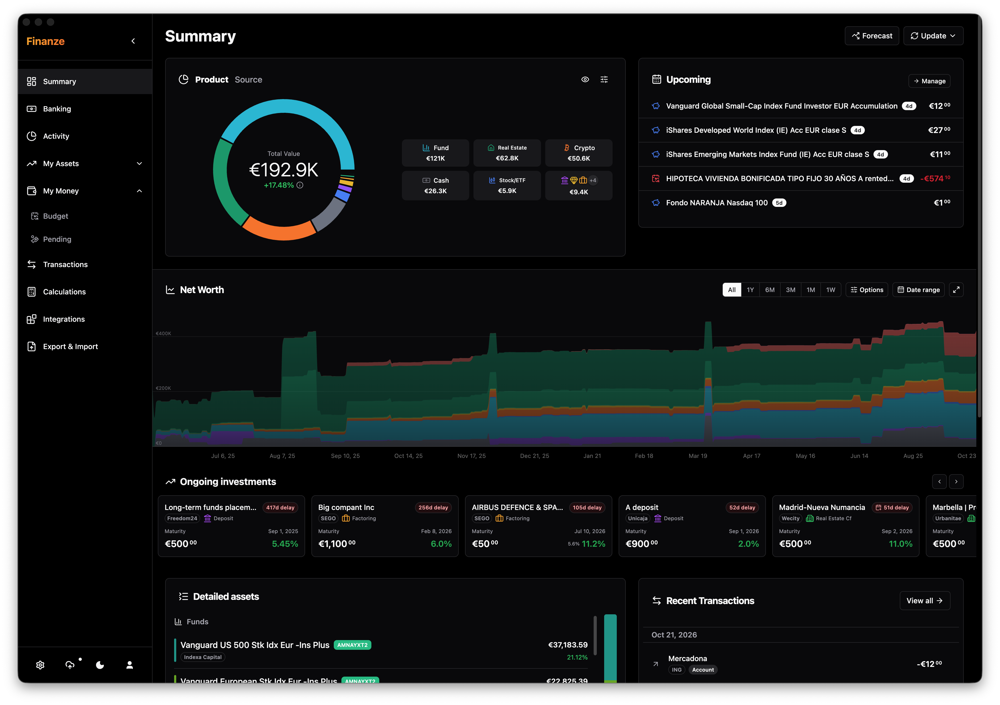
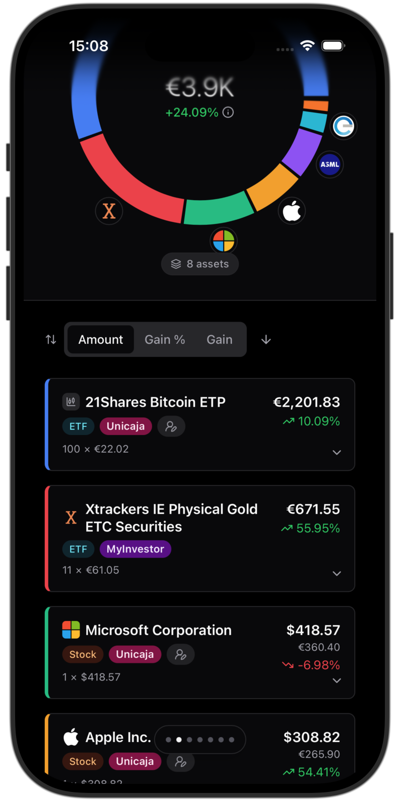
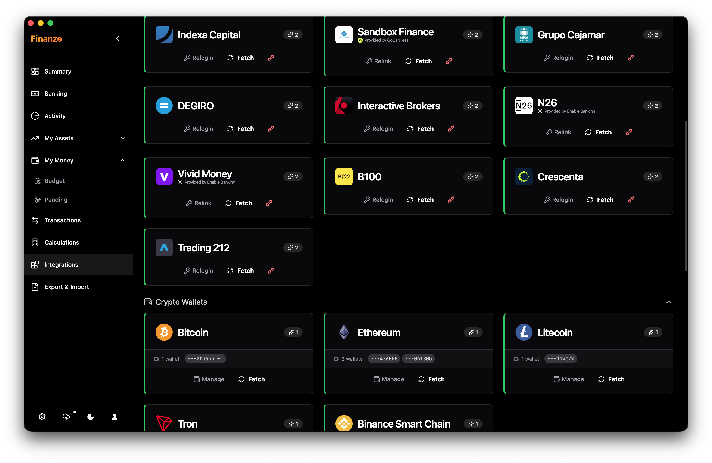
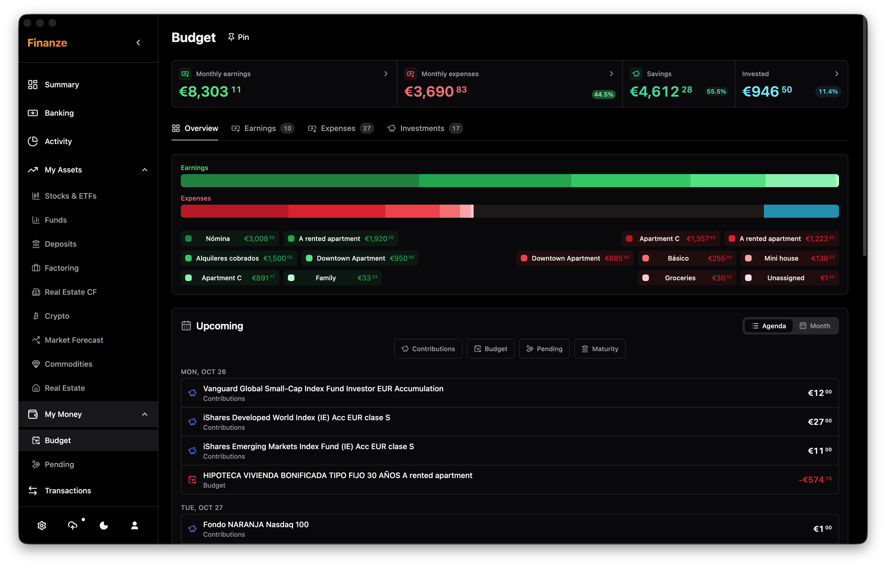
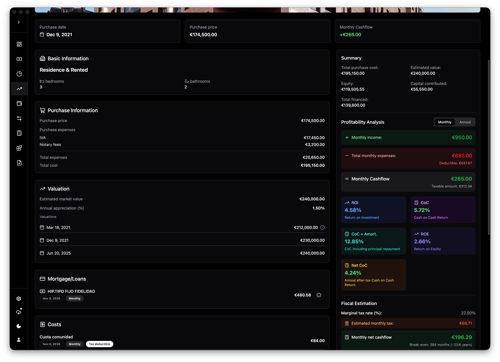
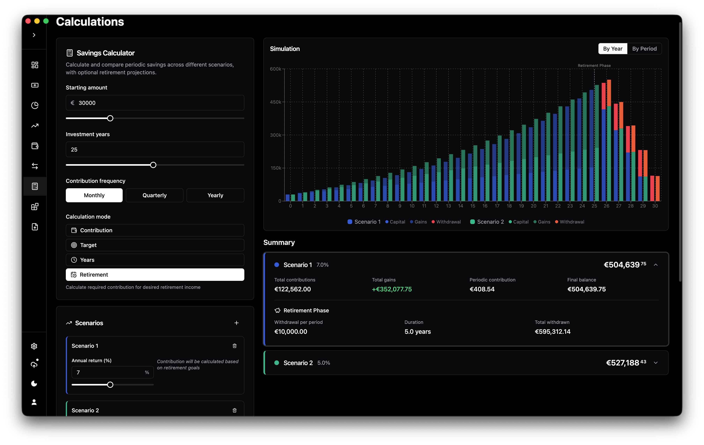
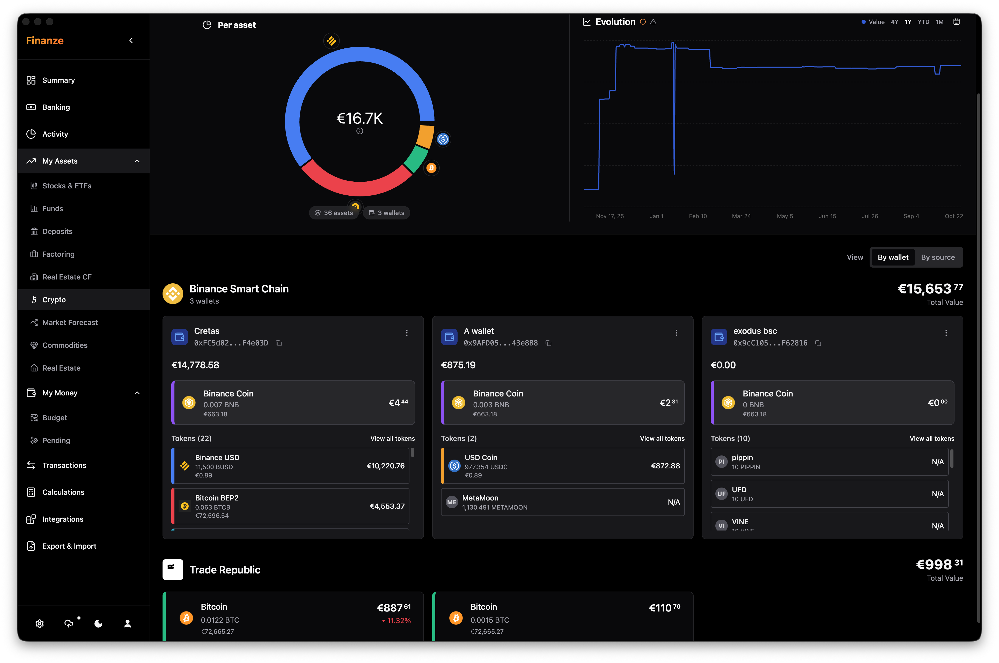
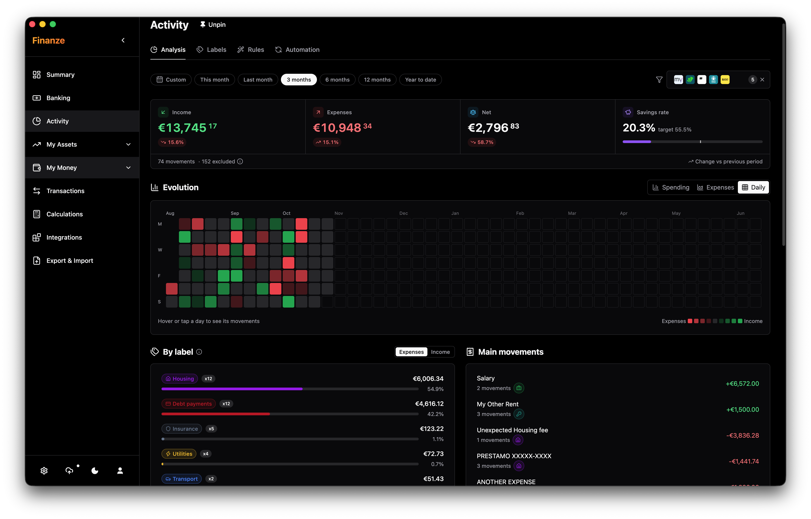

<div align="center">

[English](../README.md) · [Deutsch](README.de.md) · [Português](README.pt.md) · [Español](README.es.md) · **Italiano** · [Français](README.fr.md)

</div>

<p align="center">
  <a href="https://github.com/finanze/finanze/releases/latest"></a>
</p>

<p align="center"></p>
<h1 align="center">Finanze — Gestione self-hosted delle finanze personali e del patrimonio</h1>

<p align="center">
<a href="https://finanze.me">Finanze</a> è un'applicazione privata, self-hosted e open source per la gestione delle finanze personali e dei portafogli di investimento. Riunisce in un'unica applicazione asset e investimenti di banche, broker, piattaforme di crowdfunding, exchange e wallet di criptovalute e immobili.
Si collega a enti finanziari reali tramite canali pubblici e open banking (PSD2), supporta vari tipi di asset (immobili, criptovalute, fondi, azioni, materie prime...) e archivia tutto in un database locale cifrato.
</p>

<h3 align="center">Disponibile per</h3>

<table align="center">
  <tr>
    <td align="center" width="30%"><b>🖥️ Desktop</b></td>
    <td align="center" width="30%"><b>📱 Android</b></td>
    <td align="center" width="40%"><b>🍎 iOS</b></td>
  </tr>
  <tr>
    <td align="center">
      Ultima versione<br>
      <a href="https://github.com/finanze/finanze/releases/latest">Scarica qui</a>
    </td>
    <td align="center">
      Disponibile su <br>
      <a href="https://finanze.en.uptodown.com/android" title="Scarica Finanze"> Uptodown</a>
      <br>
      <b>oppure </b><a href="https://github.com/finanze/finanze/releases/latest">scarica il file .apk</a>
    </td>
    <td align="center">
      Installa <a href="https://altstore.io/download"> AltStore</a>, poi <a href="https://addaltstore.finanze.me">aggiungi l'app</a><br>
      <b>oppure </b>iscriviti a <a href="https://testflight.finanze.me">TestFlight</a><br>
      <b>oppure </b><a href="https://apps.apple.com/es/app/finanze-portfolio-tracker/id6763042710"></a>*
    </td>
  </tr>
</table>

<h2 align="center"></h2>

<p align="middle">
  
  
  
  
  
  
  
  
</p>

## Indice

- [Funzionalità](#features)
- [Utilizzo](#usage)
- [Sviluppo](#development)
- [Crediti](#credits)

<a id="features"></a>
## Funzionalità

- 🔄 Recupera dati finanziari da più entità
- 💼 Supporto per diversi prodotti finanziari:
    - 📈 Azioni, fondi, portafogli, conti, crowdfunding immobiliare, criptovalute e altro, da fonti reali o importati
    - 🏠 Investimenti immobiliari con varie metriche e KPI
    - 🪙 Materie prime con monitoraggio del valore di mercato
- 💵 Monitoraggio di entrate, uscite e contributi periodici agli asset per prevedere le posizioni future
- 📊 Budget mensili per necessità, desideri e investimenti, con reddito residuo e suddivisione delle spese per etichetta
- 🤖 Classificazione delle transazioni assistita dall'IA, con regole personalizzate e suggerimenti di modelli cloud, self-hosted o locali
- 🧠 Importazione di file con IA per estrarre posizioni e transazioni da estratti conto, PDF e immagini
- 💱 Supporto multivaluta con recupero automatico dei tassi di cambio
- 🔐 Database locale cifrato per archiviare i dati in sicurezza
- 🤖 Server MCP per client IA
- 📤 Esportazione dinamica e personalizzabile in Google Sheets, CSV, TSV ed Excel
- 📥 Importazione di file CSV, TSV, Excel, HTML e PDF con rilevamento automatico delle colonne, oltre a Google Sheets
- ⚙️ Configurazione flessibile con modelli per importazioni ed esportazioni
- 📊 Calcolatore avanzato di risparmio e pensione con più scenari e variabili

### Budget mensili

Imposta obiettivi mensili per necessità, desideri e contributi agli investimenti e confrontali con entrate e uscite effettive. Visualizza gli importi disponibili o superati, monitora il reddito residuo nel tempo e analizza le spese per etichetta.

### Etichette, regole e IA per le transazioni

Crea etichette e regole per classificare le transazioni. Le regole possono basarsi su testo, tipo, importo, valuta, date, entità o IBAN della transazione. Visualizza l'anteprima delle corrispondenze prima di applicare le regole, anche alle transazioni esistenti. I provider IA possono suggerire etichette e, se supportati, i modelli in grado di prendere decisioni possono restituire punteggi di affidabilità.

### Provider IA

L'IA viene usata per classificare le transazioni e importare file. Collega OpenAI (chiave API), ChatGPT (piano Plus o Pro), OpenRouter, GitHub Copilot, Anthropic Claude tramite Claude Code, un endpoint personalizzato compatibile con OpenAI oppure modelli locali in **Entities > Providers > AI providers**. GitHub Copilot e Claude Code sono disponibili nelle distribuzioni desktop e self-hosted.

### Modelli locali e self-hosted

- **Modelli locali:** Esegui modelli GGUF con il motore llama.cpp integrato su desktop. Scarica modelli consigliati o da Hugging Face, importa un file GGUF oppure collega il tuo server llama.cpp in modalità router. I modelli con un proiettore visivo (`mmproj`) possono leggere immagini e PDF scansionati.
- **IA personalizzata:** Collega un'API compatibile con OpenAI, come Ollama, LM Studio, vLLM o un server llama.cpp con un solo modello, usando il suo URL di base e una chiave API facoltativa.

Il motore integrato esegue i modelli sul dispositivo ed è disponibile solo su desktop. Gli endpoint esterni devono essere raggiungibili da Finanze.

### Server MCP

Finanze include un server Model Context Protocol (MCP) che consente ai client IA compatibili di accedere ai dati e agli strumenti supportati di Finanze. Nell'app, apri **Settings > MCP** per abilitare il server, scegliere una modalità di accesso e copiare i dati di connessione per il client. L'accesso in sola lettura è attivo per impostazione predefinita. L'accesso in scrittura consente agli strumenti supportati di creare, modificare ed eliminare dati, collegare integrazioni e recuperare dati dalle entità.

### Asset supportati per entità finanziaria ed exchange crypto

| Entità finanziaria | Conti | Carte | Fondi | Azioni/<br>ETF | Depositi | Portafogli | Prestiti/<br>Mutui | Crypto | Obbligazioni | Specifico |
| ------------------ | ----- | ----- | ----- | ------------- | -------- | ---------- | ----------------- | ------ | ------------ | --------- |
| Urbanitae | ✅ | - | - | - | - | - | - | - | - | Investimenti di credito |
| MyInvestor | ✅ | ✅ | ✅ | ✅ | ✅ | ✅ | Crediti | - | - | |
| SEGO | ✅ | - | - | - | - | - | - | - | - | Factoring |
| Trade Republic | ✅ | - | ✅ | ✅ | - | - | - | ✅ | ❌ | Mercati privati |
| Unicaja | ✅ | ✅ | ❌ | ❌ | ❌ | - | ✅ | - | - | |
| Wecity | ✅ | - | - | - | - | - | - | - | - | Investimenti |
| Mintos | ✅ (Smart Cash) | - | - | Azioni ed ETF singoli | - | - | - | ❌ | ❌ | Crowdlending |
| Freedom24 | ✅ | - | - | ✅ | - | - | - | ❌ | - | Vecchi prodotti strutturati |
| Indexa Capital | ✅ | - | ✅️ | - | - | ✅️ | - | - | - | |
| ING | ✅ | ✅ | ✅️ | ✅ | ❌ | - | ❌ | - | - | |
| Grupo Cajamar | ✅ | ✅ | ❌️ | ❌ | ❌ | - | ✅ | - | - | |
| DEGIRO | ✅ | - | ✅️ | ✅️ | - | - | - | - | - | |
| Interactive Brokers | ✅ | - | ❌ | ✅️ Azioni | - | - | - | - | ❌ | |
| B100 | ✅ | ✅ | - | - | - | - | - | - | - | |
| Crescenta | - | - | ✅ | - | - | - | - | - | - | |
| Trading 212 (Beta) | ✅ | - | - | ✅ | - | - | - | ❌ | - | |

| Exchange crypto | Crypto | Specifico |
| --------------- | ------ | --------- |
| Binance | ✅ Spot & Futures | Futures |

#### Integrazione Enable Banking

Consente di collegare banche dell'UE non supportate nativamente dall'app tramite informazioni bancarie conformi alla PSD2.
Le istruzioni per la configurazione sono nella scheda Settings/Integrations dell'app.

#### Integrazione GoCardless

Se hai già un account, GoCardless è un'altra opzione che fornisce informazioni bancarie conformi alla PSD2 per molte banche dell'UE e del Regno Unito.

### Funzionalità di entità finanziarie ed exchange crypto

Non tutte le entità supportano le stesse funzionalità. In generale, i dati possono essere suddivisi nelle seguenti categorie:

- **Posizione globale:** posizione finanziaria attuale, compreso lo stato corrente degli asset elencati sopra; è supportata da tutte le entità.
- **Contributi periodici:** contributi automatici e periodici agli investimenti, ad esempio in fondi (MyInvestor) o azioni/ETF (Trade Republic).
- **Transazioni:** tutte le transazioni relative a conti o investimenti, pagamenti di interessi, operazioni su azioni o fondi, scadenze, commissioni...
- **Storico degli investimenti:** aggrega posizioni precedenti e transazioni per creare uno storico degli investimenti passati e attuali (i depositi non sono inclusi).

| Entità finanziaria | Posizione globale | Contributi<br>periodici | Transazioni<br>(relative agli investimenti) | Storico degli<br>investimenti |
| ------------------ | ----------------- | ----------------------- | ------------------------------------------ | ------------------------------ |
| Urbanitae | ✅ | - | ✅ | ✅ |
| MyInvestor | ✅ | ✅ | ✅ | ❌ |
| SEGO | ✅ | - | ✅ | ✅ |
| Trade Republic | ✅ | ✅ | ✅ | - |
| Unicaja | ✅ | ✅ | ❌ | - |
| Wecity | ✅ | - | ✅ | ✅ |
| Mintos | ✅ | - | Azioni ed ETF singoli | ❌ |
| Freedom24 | ✅ | - | ✅ | ❌ |
| Indexa Capital | ✅ | - | ✅ | - |
| ING | ✅ | ✅ | ✅ | - |
| Grupo Cajamar | ✅ | - | ❌ | - |
| DEGIRO | ✅ | ❌ | ✅ | - |
| Interactive Brokers | ✅ | ❌ | ✅⚠️ | - |
| B100 | ✅ | ❌ | ✅ (interessi) | - |
| Crescenta | ✅ | - | ✅ | - |
| Trading 212 (Beta) | ✅ | ❌ | ✅ | - |

| Exchange crypto | Posizione globale | Contributi<br>periodici | Transazioni<br>(relative agli investimenti) | Storico degli<br>investimenti |
| --------------- | ----------------- | ----------------------- | ------------------------------------------ | ------------------------------ |
| Binance | ✅ Spot | ❌ | ✅️ | - |

### Note sulle entità finanziarie

Alcune entità richiedono l'autenticazione a due fattori (2FA) per accedere o recuperare i dati, impedendo gli aggiornamenti in background. Questo riguarda:

- **SEGO** (e-mail)
- **Trade Republic** (app mobile o SMS)
- **Wecity** (SMS)
- A volte **MyInvestor** (SMS), che può anche richiedere un CAPTCHA
- **DEGIRO** (conferma nell'app mobile)

Note importanti:

- **Unicaja**:
    - Può non funzionare occasionalmente nell'app mobile.
    - Se non usi l'app, per accedere devi impostare la variabile d'ambiente `UNICAJA_ABCK`, poiché viene usato Akamai per la protezione dai bot.
- **Mintos** richiede Selenium per risolvere reCAPTCHA al di fuori dell'app.
- **Trade Republic**, **ING** e **IBKR** funzionano solo tramite app, perché per accedere è necessaria un'azione dell'utente.
- Gli interessi del conto D di **Freedom24** e le relative transazioni erano supportati, ma non lo sono più dopo la loro rimozione.

### Criptovalute

Le criptovalute sono prodotti finanziari, non entità finanziarie. Per aggiungerle basta configurare un wallet. Attualmente sono supportati:

- **Bitcoin** (supporto xpub)
- **Ethereum**: sono supportati anche i token ERC20.
- **Litecoin** (supporto xpub)
- **Tron**: sono supportati anche i token TRC20.
- **Binance Smart Chain**: sono supportati anche i token BSC (è necessario configurare l'integrazione Etherscan con una chiave API).

Al momento, l'unica funzionalità disponibile per le criptovalute è la **Posizione globale**; le transazioni sono in lavorazione.

Alcune entità finanziarie, come Trade Republic, supportano anche le criptovalute.

#### Zerion

È supportato anche Zerion (tramite una chiave API gratuita), che permette di monitorare più asset crypto e DeFi.

#### Altri tipi di entità

L'app consente anche di monitorare mercati di previsione come Polymarket, incluse transazioni, profitti e perdite (PnL) e posizioni attuali e storiche (non dati inseriti manualmente).

### Materie prime

L'inserimento manuale delle materie prime consente di monitorarne il valore di mercato. Attualmente sono supportate:

- **Oro**
- **Argento**
- **Platino**
- **Palladio**

<a id="export-import"></a>
### Importazione ed esportazione

Posizioni e transazioni possono essere importate ed esportate in diversi modi:

- **File:** esportazione in CSV, TSV ed Excel. Importazione da CSV, TSV, Excel (XLS/XLSX), tabelle HTML e PDF testuali.
  Le colonne vengono rilevate automaticamente oppure associate manualmente o tramite un modello salvato, con un'anteprima prima del salvataggio.
- **Importazione IA:** estrae dati senza modelli dai formati elencati sopra, da testo semplice e immagini (PNG, JPEG, WebP, GIF e HEIC su mobile), inclusi PDF scansionati. Supporta istruzioni aggiuntive e provider di fallback. Immagini e PDF scansionati richiedono un modello con capacità visive. I risultati vengono mostrati in anteprima prima del salvataggio.
- **Google Sheets:** esporta e importa collegando un account Google in **Entities > Providers**. I dati dei fogli importati costituiscono una fonte a sé: ogni importazione sostituisce i dati Google Sheets precedenti senza modificare i dati reali o inseriti manualmente.

#### Modelli

I modelli rendono importazione ed esportazione ampiamente personalizzabili e definiscono la struttura delle tabelle, la formattazione dei dati, i filtri e altre opzioni. Sono facoltativi per l'importazione di file e definiscono le importazioni da Google Sheets.

Consulta la [Importazione ed esportazione](#export-import) per ulteriori informazioni tecniche.

<a id="usage"></a>
## Utilizzo

### Download

Scarica l'ultima versione dell'app per il tuo sistema operativo dalla pagina [Releases](https://github.com/finanze/finanze/releases).

Vuoi provare le funzionalità più recenti ancora in sviluppo? Scarica una build dal [`next` pre-release](https://github.com/finanze/finanze/releases/tag/next), aggiornata automaticamente a ogni push su `develop`. Queste build possono essere instabili e non sono destinate all'uso in produzione.

### Docker

Sono disponibili due immagini Docker: una con Selenium (`latest-selenium`) e una predefinita più leggera (`latest`).

Se non usi Mintos, è consigliata `latest`.
La prima è necessaria per Mintos, poiché include Selenium e le dipendenze Python e di sistema operativo necessarie per risolvere reCAPTCHA (come ffmpeg).

Entrambe sono disponibili su Docker Hub: [finanze/finanze](https://hub.docker.com/r/finanze/finanze).

Il frontend è disponibile su [finanze/finanze-frontend](https://hub.docker.com/r/finanze/finanze-frontend).

Per una configurazione completa, consulta l'esempio [docker-compose.yml](../docker-compose.yml).

<a id="development"></a>
## Sviluppo

Questo progetto richiede `Python 3.14`.
Per il frontend servono `pnpm` e `Node 24`.

### Configurazione

1. Clona il repository:

    ```sh
    git clone https://github.com/finanze/finanze.git
    cd finanze
    ```

2. Crea e attiva un ambiente virtuale (si consiglia Pyenv per gestire le versioni di Python):

    ```sh
    python3 -m venv venv
    source venv/bin/activate
    ```

3. Installa le dipendenze necessarie:

    ```sh
    pip install -r requirements.txt -r requirements-dev.txt -r requirements-lint.txt -r requirements-packaging.txt
    pip install -r requirements-selenium.txt  # If you want to use Selenium for reCAPTCHA, only for Mintos
    pre-commit install
    ```

4. Configura il frontend:

    ```sh
    cd frontend/app
    pnpm install
                         # ---- Mobile SPECIFIC ----
    pnpm install:pyodide # For mobile app initial setup, it will download Pyodide and all required Python dependencies for mobile backend
    ```

5. Avvia l'app:

    ```sh
    python ./finanze/finanze --port 7592 --data-dir .storage --log-dir .storage/logs --log-level DEBUG --third-party-log-level DEBUG

    cd frontend/app
    pnpm dev            # For electron desktop app

                        # ---- Mobile SPECIFIC ----
    pnpm dev:mobile     # For mobile app (web feature limited, but useful for basic development and testing)
    pnpm cap:ios        # For iOS development (requires Xcode and Mac)
    pnpm cap:android    # For Android development (requires Android Studio and related SDKs
    pnpm cap:sync       # To sync changes to native projects after frontend development

                        # ---- App Store SPECIFIC ----
    pnpm cap:sync:store # Same as above but this excludes all non App/Play Store compliant stuff (entity connections)
    ```

#### Passaggio aggiuntivo per mobile

6. Client TLS per mobile (necessario per alcune entità che richiedono l'impersonificazione dell'impronta TLS):

    Requisiti: Go, Xcode completo con SDK iOS e simulatore (iOS), JDK 21+ e Android NDK r28+ (Android), gomobile (`go install golang.org/x/mobile/cmd/gomobile@latest && go install golang.org/x/mobile/cmd/gobind@latest`).

    ```sh
    cd frontend/app           # If not already
    go mod tidy -C native/tlsclient
    pnpm native:setup         # Builds iOS xcframework + Android AAR and copies to native projects
    # Or build only the platform you need:
    pnpm native:setup:ios
    pnpm native:setup:android
    ```

    <details>
    <summary>Configurazione della toolchain Android e iOS</summary>

    **Android:** Installa **NDK (Side by side)** in Android Studio > SDK Manager > SDK Tools.
    La build nativa seleziona automaticamente l'installazione NDK completa più recente nella directory `ndk/` dell'SDK.
    Cerca prima in `ANDROID_HOME`, poi in `ANDROID_SDK_ROOT` e infine nella posizione predefinita
    (`~/Library/Android/sdk` su macOS, `~/Android/Sdk` su Linux).
    Imposta `ANDROID_NDK_HOME` (o `ANDROID_NDK_ROOT`) per sostituire il rilevamento; un percorso non valido genera un errore invece di ricorrere a un altro percorso.
    Imposta `JAVA_HOME` su un JDK, non su un JRE. Se non è impostata, la build nativa avvisa e controlla gli strumenti Java in `PATH`.

    ```sh
    # macOS: select an installed JDK 21
    export JAVA_HOME="$(/usr/libexec/java_home -v 21)"
    # Only needed for custom SDK/NDK locations or to pin an NDK version:
    export ANDROID_HOME="$HOME/Library/Android/sdk"
    export ANDROID_NDK_HOME="$ANDROID_HOME/ndk/<installed-version>"
    ```

    Sostituisci `<installed-version>` con il nome della directory NDK installata. Aggiungi le esportazioni necessarie al profilo della shell
    (ad esempio `~/.zshrc`) per mantenerle nei terminali successivi.

    **iOS (macOS):** I soli Command Line Tools non bastano. Installa e apri Xcode per completare la configurazione iniziale
    e installare i componenti della piattaforma iOS. Se `xcode-select -p` punta a `/Library/Developer/CommandLineTools`
    o a un'altra installazione di Xcode, imposta la directory sviluppatore per il comando di configurazione:

    ```sh
    DEVELOPER_DIR="/Applications/Xcode.app/Contents/Developer" pnpm native:setup:ios
    ```

    Modifica il percorso se Xcode è installato altrove. Per selezionarlo anche nei comandi futuri:
    `sudo xcode-select --switch /Applications/Xcode.app/Contents/Developer`.
    Prima della build, la compilazione nativa controlla entrambi gli SDK iOS e indica come impostare `DEVELOPER_DIR` se non sono disponibili.

    </details>

#### Altro

##### Formattazione

    ```sh
    ruff format

    cd frontend/app
    pnpm format
    ```

##### Esecuzione dei test

    ```sh
    pytest              # Backend

    cd frontend/app
    pnpm test           # Frontend

    cd e2e/standard
    pnpm test           # Web based E2E

    cd e2e/mobile
    pnpm local:both     # Mobile based basic E2E
    ```

### Variabili d'ambiente

Consulta l'esempio docker-compose.yml per le variabili d'ambiente che consentono di modificare la configurazione predefinita. Le più importanti sono:

- `USERNAME` e `PASSWORD` sono facoltative e avviano automaticamente una sessione al caricamento.
- `MULTI_USER` è facoltativa e consente la registrazione di più utenti (consigliata solo per lo sviluppo locale).
- Altre variabili relative a Selenium.

<a id="credits"></a>
## Crediti

- Dati forniti da [CoinGecko](https://www.coingecko.com/).
- Dati forniti da [CoinMarketCap](https://coinmarketcap.com/).
- Dati forniti da [CryptoCompare](https://www.cryptocompare.com/).
- [Pyodide](https://github.com/pyodide/pyodide) viene utilizzato per la compatibilità del backend mobile.
- L'icona di Llama.cpp proviene da [ggml-org/llama.brand](https://github.com/ggml-org/llama.brand) ed è usata secondo la [policy di utilizzo del marchio](https://github.com/ggml-org/llama.brand/blob/master/BRAND-USAGE.md) (CC BY-NC 4.0).
- Il client Trade Republic si basa sul progetto [pytr-org/pytr](https://github.com/pytr-org/pytr), che è stato modificato ampiamente; questa libreria è stata fondamentale per l'integrazione dell'entità.
- La risoluzione di reCAPTCHA con Selenium si basa sul progetto [sarperavci/GoogleRecaptchaBypass](https://github.com/sarperavci/GoogleRecaptchaBypass/tree/selenium) e usa una versione di Selenium leggermente modificata. È disponibile [qui](../finanze/infrastructure/client/entity/financial/mintos/recaptcha_solver_playwright.py) un adattamento per Playwright, che presenta ancora problemi in modalità headless.

---

<small>* La versione App Store ha funzionalità limitate e non supporta i collegamenti bancari. Per l'esperienza completa, usa AltStore o TestFlight.</small>
