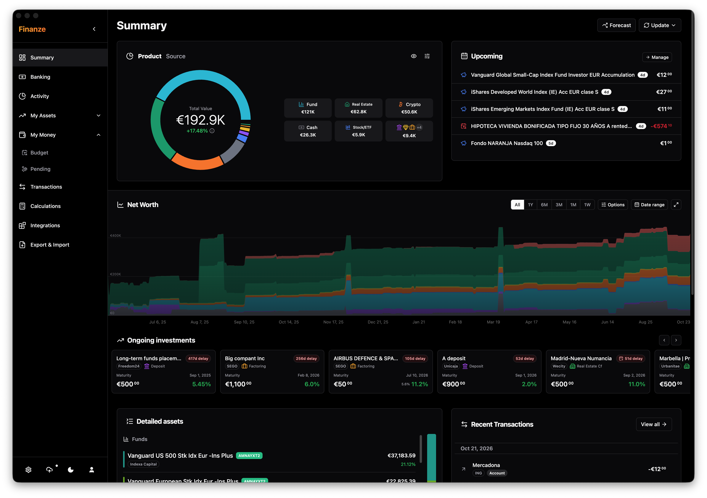
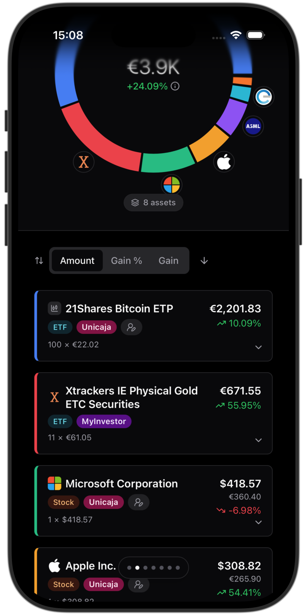
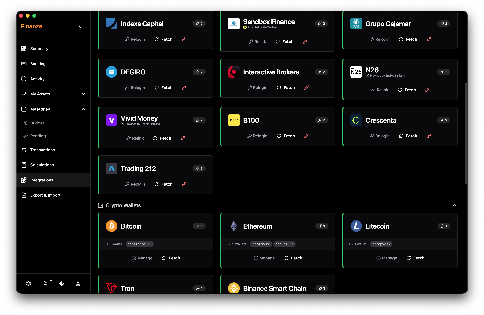
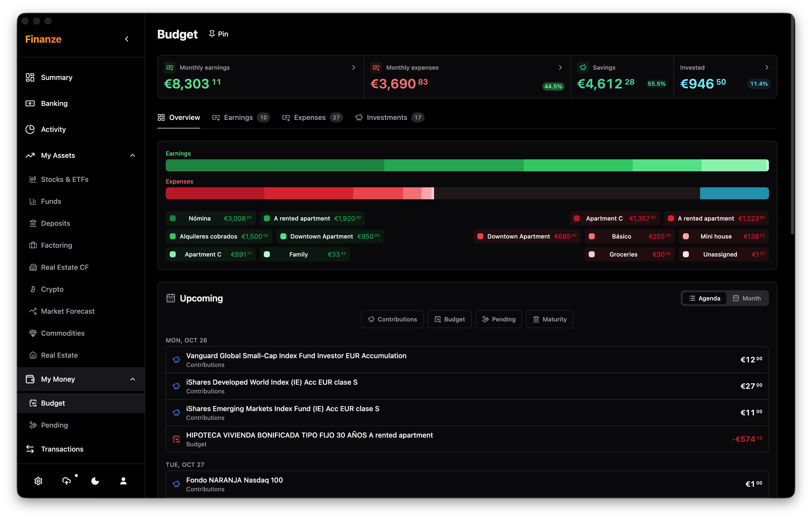
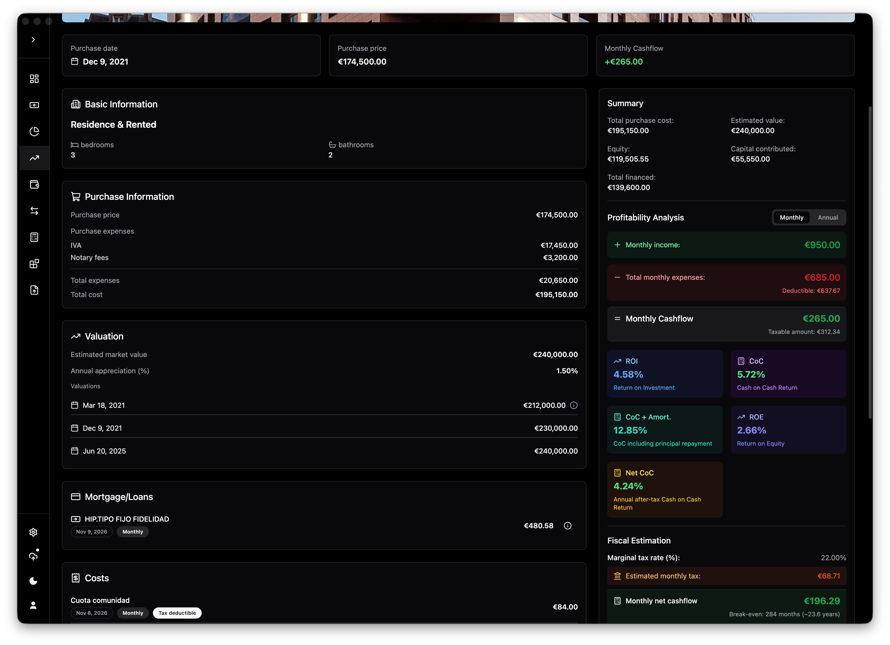
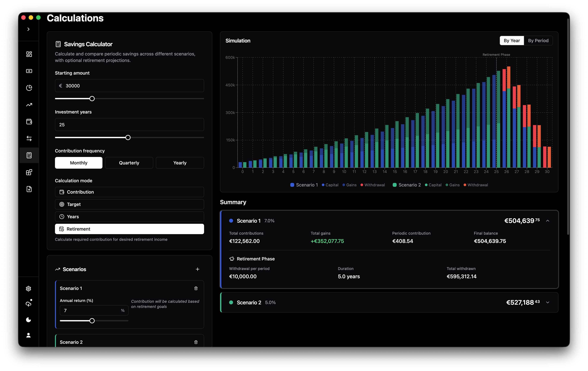
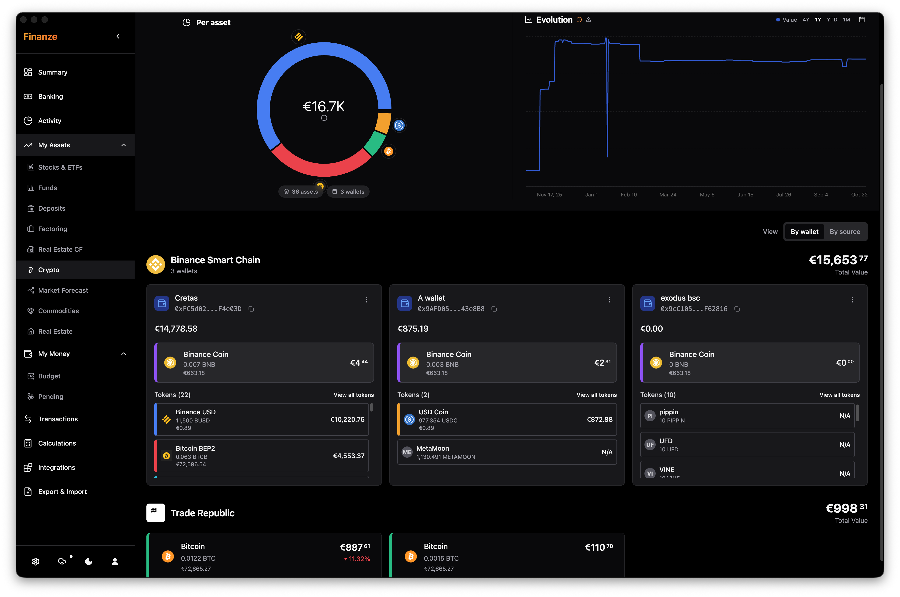
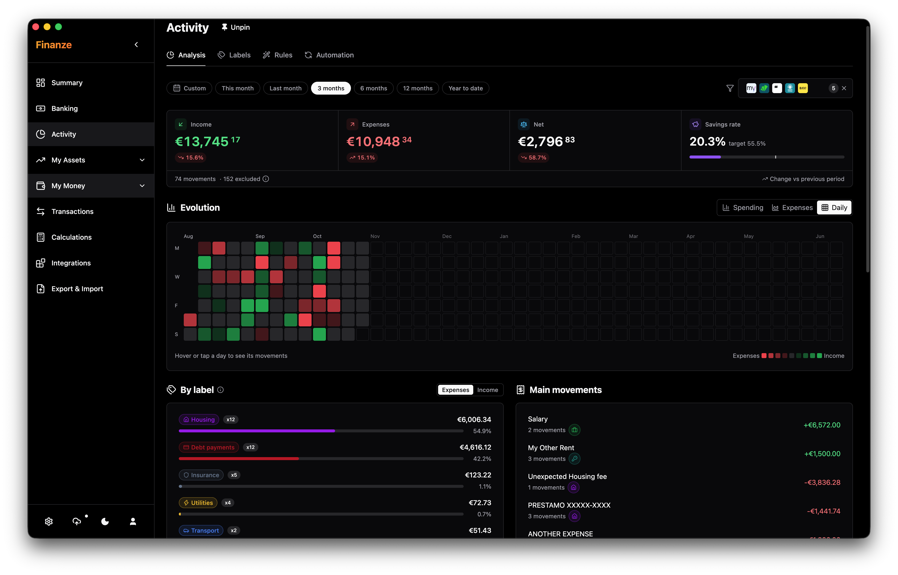

<div align="center">

[English](../README.md) · [Deutsch](README.de.md) · **Português** · [Español](README.es.md) · [Italiano](README.it.md) · [Français](README.fr.md)

</div>

<p align="center">
  <a href="https://github.com/finanze/finanze/releases/latest"></a>
</p>

<p align="center"></p>
<h1 align="center">Finanze — Gestor de Finanças Pessoais e Património Autoalojado</h1>

<p align="center">
<a href="https://finanze.me">Finanze</a> é uma aplicação privada, autoalojada e de código aberto para gerir finanças pessoais e carteiras de investimento. Reúne numa única aplicação os seus ativos e investimentos em bancos, corretoras, plataformas de crowdfunding, exchanges e carteiras de criptomoedas e imóveis.
Liga-se a entidades financeiras reais através de meios públicos e de open banking (PSD2), suporta vários tipos de ativos (imóveis, criptomoedas, fundos, ações, matérias-primas...) e guarda tudo numa base de dados local cifrada.
</p>

<h3 align="center">Disponível para</h3>

<table align="center">
  <tr>
    <td align="center" width="30%"><b>🖥️ Desktop</b></td>
    <td align="center" width="30%"><b>📱 Android</b></td>
    <td align="center" width="40%"><b>🍎 iOS</b></td>
  </tr>
  <tr>
    <td align="center">
      Versão mais recente<br>
      <a href="https://github.com/finanze/finanze/releases/latest">Transferir aqui</a>
    </td>
    <td align="center">
      Disponível em <br>
      <a href="https://finanze.en.uptodown.com/android" title="Transferir o Finanze"> Uptodown</a>
      <br>
      <b>ou </b><a href="https://github.com/finanze/finanze/releases/latest">transferir o .apk</a>
    </td>
    <td align="center">
      Instale o <a href="https://altstore.io/download"> AltStore</a> e, em seguida, <a href="https://addaltstore.finanze.me">adicione a aplicação</a><br>
      <b>ou </b>inscreva-se no <a href="https://testflight.finanze.me">TestFlight</a><br>
      <b>ou </b><a href="https://apps.apple.com/es/app/finanze-portfolio-tracker/id6763042710"></a>*
    </td>
  </tr>
</table>

<h2 align="center"></h2>

<p align="middle">
  
  
  
  
  
  
  
  
</p>

## Índice

- [Funcionalidades](#features)
- [Utilização](#usage)
- [Desenvolvimento](#development)
- [Créditos](#credits)

<a id="features"></a>
## Funcionalidades

- 🔄 Obtenha dados financeiros de várias entidades
- 💼 Suporte para vários produtos financeiros:
    - 📈 Ações, fundos, carteiras, contas, crowdfunding imobiliário, criptomoedas, entre outros, de fontes reais ou importados
    - 🏠 Investimentos imobiliários com várias métricas e KPIs
    - 🪙 Matérias-primas com acompanhamento do valor de mercado
- 💵 Registo de receitas, despesas e contribuições periódicas para prever posições futuras
- 📊 Orçamentos mensais para necessidades, desejos e investimentos, com saldo disponível e despesas discriminadas por etiqueta
- 🤖 Classificação de transações assistida por IA, com regras personalizadas e sugestões de modelos na nuvem, autoalojados ou executados no dispositivo
- 🧠 Importação de ficheiros com IA para extrair posições e transações de extratos, PDFs e imagens
- 💱 Suporte para várias moedas e obtenção automática de taxas de câmbio
- 🔐 Base de dados local cifrada para guardar os dados em segurança
- 🤖 Servidor MCP para clientes de IA
- 📤 Exportação dinâmica e personalizável para Google Sheets, CSV, TSV e Excel
- 📥 Importação de ficheiros CSV, TSV, Excel, HTML e PDF, com deteção automática de colunas, e de Google Sheets
- ⚙️ Configuração detalhada com modelos de importação e exportação
- 📊 Calculadora avançada de poupança e reforma com vários cenários e variáveis

### Orçamentação mensal

Defina objetivos mensais para necessidades, desejos e contribuições de investimento e compare-os com as receitas e despesas reais. Consulte os montantes disponíveis ou ultrapassados, acompanhe o saldo ao longo do tempo e analise as despesas por etiqueta.

### Etiquetas, regras e IA para transações

Crie etiquetas e regras para categorizar transações. As regras podem corresponder ao texto, tipo, montante, moeda, datas, entidades ou IBAN das transações. Pré-visualize as correspondências antes de aplicar as regras, inclusive a transações existentes. Os fornecedores de IA podem sugerir etiquetas e, quando suportado, os modelos capazes de tomar decisões podem devolver níveis de confiança.

### Fornecedores de IA

A IA é usada para classificar transações e importar ficheiros. Ligue-se ao OpenAI (chave de API), ChatGPT (plano Plus ou Pro), OpenRouter, GitHub Copilot, Anthropic Claude através do Claude Code, a um endpoint personalizado compatível com OpenAI ou a modelos locais em **Entities > Providers > AI providers**. O GitHub Copilot e o Claude Code estão disponíveis nas distribuições desktop e autoalojadas.

### Modelos locais e autoalojados

- **Modelos locais:** Execute modelos GGUF com o motor llama.cpp integrado no desktop. Descarregue modelos recomendados ou do Hugging Face, importe um ficheiro GGUF ou ligue o seu próprio servidor llama.cpp em modo router. Modelos com um projetor de visão (`mmproj`) conseguem ler imagens e PDFs digitalizados.
- **IA personalizada:** Ligue uma API compatível com OpenAI, como Ollama, LM Studio, vLLM ou um servidor llama.cpp de modelo único, através do URL base e de uma chave de API opcional.

O motor integrado executa modelos no dispositivo e está disponível apenas no desktop. Os endpoints externos têm de estar acessíveis a partir do Finanze.

### Servidor MCP

O Finanze inclui um servidor Model Context Protocol (MCP) que permite a clientes de IA compatíveis aceder a dados e ferramentas suportados do Finanze. Na aplicação, abra **Settings > MCP** para ativar o servidor, escolher um modo de acesso e copiar os dados de ligação para o seu cliente. O acesso só de leitura está ativado por predefinição. O acesso de escrita permite que as ferramentas suportadas criem, editem e eliminem dados, liguem integrações e obtenham dados de entidades.

### Ativos suportados por entidade financeira e exchanges de criptomoedas

| Entidade financeira | Contas | Cartões | Fundos | Ações/<br>ETFs | Depósitos | Carteiras | Empréstimos/<br>Hipotecas | Cripto | Obrigações | Específico |
| ------------------- | ------ | ------- | ------ | ------------- | --------- | --------- | ------------------------- | ----- | ---------- | ---------- |
| Urbanitae | ✅ | - | - | - | - | - | - | - | - | Investimentos de crédito |
| MyInvestor | ✅ | ✅ | ✅ | ✅ | ✅ | ✅ | Créditos | - | - | |
| SEGO | ✅ | - | - | - | - | - | - | - | - | Factoring |
| Trade Republic | ✅ | - | ✅ | ✅ | - | - | - | ✅ | ❌ | Mercados privados |
| Unicaja | ✅ | ✅ | ❌ | ❌ | ❌ | - | ✅ | - | - | |
| Wecity | ✅ | - | - | - | - | - | - | - | - | Investimentos |
| Mintos | ✅ (Smart Cash) | - | - | Ações e ETFs individuais | - | - | - | ❌ | ❌ | Crowdlending |
| Freedom24 | ✅ | - | - | ✅ | - | - | - | ❌ | - | Produtos estruturados antigos |
| Indexa Capital | ✅ | - | ✅️ | - | - | ✅️ | - | - | - | |
| ING | ✅ | ✅ | ✅️ | ✅ | ❌ | - | ❌ | - | - | |
| Grupo Cajamar | ✅ | ✅ | ❌️ | ❌ | ❌ | - | ✅ | - | - | |
| DEGIRO | ✅ | - | ✅️ | ✅️ | - | - | - | - | - | |
| Interactive Brokers | ✅ | - | ❌ | ✅️ Ações | - | - | - | - | ❌ | |
| B100 | ✅ | ✅ | - | - | - | - | - | - | - | |
| Crescenta | - | - | ✅ | - | - | - | - | - | - | |
| Trading 212 (Beta) | ✅ | - | - | ✅ | - | - | - | ❌ | - | |

| Exchange de criptomoedas | Cripto | Específico |
| ------------------------- | ------ | ---------- |
| Binance | ✅ Spot & Futures | Futures |

#### Integração do Enable Banking

Permite ligar-se a bancos da UE que não são suportados diretamente pela aplicação, através de informações bancárias em conformidade com a PSD2.
As instruções de configuração estão disponíveis no separador Settings/Integrations da aplicação.

#### Integração do GoCardless

Se já tiver uma conta, o GoCardless é outra opção que também fornece informações bancárias em conformidade com a PSD2 para muitos bancos da UE e do Reino Unido.

### Funcionalidades de entidades financeiras e exchanges de criptomoedas

Nem todas as entidades suportam as mesmas funcionalidades. Em geral, os dados podem ser agrupados nas seguintes categorias:

- **Posição global:** posição financeira atual, incluindo o estado atual dos ativos indicados acima; é suportada por todas as entidades.
- **Contribuições periódicas:** contribuições automáticas e periódicas para investimentos, como fundos (MyInvestor) ou ações/ETFs (Trade Republic).
- **Transações:** todas as transações relacionadas com contas ou investimentos, pagamentos de juros, operações de ações ou fundos, vencimentos, comissões...
- **Histórico de investimentos:** agrega posições anteriores e transações para criar um histórico dos investimentos passados e atuais (os depósitos não estão incluídos).

| Entidade financeira | Posição global | Contribuições<br>periódicas | Transações<br>(relacionadas com investimentos) | Histórico de<br>investimentos |
| ------------------- | --------------- | --------------------------- | --------------------------------------------- | ----------------------------- |
| Urbanitae | ✅ | - | ✅ | ✅ |
| MyInvestor | ✅ | ✅ | ✅ | ❌ |
| SEGO | ✅ | - | ✅ | ✅ |
| Trade Republic | ✅ | ✅ | ✅ | - |
| Unicaja | ✅ | ✅ | ❌ | - |
| Wecity | ✅ | - | ✅ | ✅ |
| Mintos | ✅ | - | Ações e ETFs individuais | ❌ |
| Freedom24 | ✅ | - | ✅ | ❌ |
| Indexa Capital | ✅ | - | ✅ | - |
| ING | ✅ | ✅ | ✅ | - |
| Grupo Cajamar | ✅ | - | ❌ | - |
| DEGIRO | ✅ | ❌ | ✅ | - |
| Interactive Brokers | ✅ | ❌ | ✅⚠️ | - |
| B100 | ✅ | ❌ | ✅ (juros) | - |
| Crescenta | ✅ | - | ✅ | - |
| Trading 212 (Beta) | ✅ | ❌ | ✅ | - |

| Exchange de criptomoedas | Posição global | Contribuições<br>periódicas | Transações<br>(relacionadas com investimentos) | Histórico de<br>investimentos |
| ------------------------- | --------------- | --------------------------- | --------------------------------------------- | ----------------------------- |
| Binance | ✅ Spot | ❌ | ✅️ | - |

### Notas sobre entidades financeiras

Algumas entidades exigem autenticação de dois fatores (2FA) para iniciar sessão ou obter dados, o que impede a atualização em segundo plano. Aplica-se a:

- **SEGO** (e-mail)
- **Trade Republic** (aplicação móvel ou SMS)
- **Wecity** (SMS)
- Por vezes **MyInvestor** (SMS), podendo também pedir um CAPTCHA
- **DEGIRO** (confirmação na aplicação móvel)

Notas importantes:

- **Unicaja**:
    - Pode falhar ocasionalmente na aplicação móvel.
    - Se não utilizar a aplicação, é necessário definir a variável de ambiente `UNICAJA_ABCK` para iniciar sessão, pois utiliza o Akamai para proteção contra bots.
- O **Mintos** precisa do Selenium para resolver reCAPTCHA fora da aplicação.
- **Trade Republic**, **ING** e **IBKR** só funcionam através da aplicação, pois exigem interação do utilizador para iniciar sessão.
- Os juros e as transações relacionadas com a conta D da **Freedom24** eram suportados, mas deixaram de o ser após a sua remoção.

### Criptomoedas

As criptomoedas são produtos financeiros, não entidades financeiras. Para as adicionar, basta configurar uma carteira digital. Atualmente, são suportadas:

- **Bitcoin** (suporte para xpub)
- **Ethereum**: também são suportados tokens ERC20.
- **Litecoin** (suporte para xpub)
- **Tron**: também são suportados tokens TRC20.
- **Binance Smart Chain**: também são suportados tokens BSC (requer a configuração de uma integração Etherscan com uma chave de API).

Atualmente, a única funcionalidade disponível para criptomoedas é a **Posição global**; as transações estão em desenvolvimento.

Algumas entidades financeiras, como a Trade Republic, também suportam criptomoedas.

#### Zerion

O Zerion também é suportado (com uma chave de API gratuita) e permite acompanhar vários ativos cripto e DeFi.

#### Outros tipos de entidades

A aplicação também permite acompanhar plataformas de previsão de mercado, como a Polymarket, incluindo transações, lucros e perdas (PnL), e posições atuais e históricas (não dados introduzidos manualmente).

### Matérias-primas

A introdução manual de matérias-primas permite acompanhar o seu valor de mercado. Atualmente, são suportadas:

- **Ouro**
- **Prata**
- **Platina**
- **Paládio**

<a id="export-import"></a>
### Importação e exportação

As posições e transações podem ser importadas e exportadas de várias formas:

- **Ficheiros:** exportação para CSV, TSV e Excel. Importação de CSV, TSV, Excel (XLS/XLSX), tabelas HTML e PDFs baseados em texto.
  As colunas são detetadas automaticamente ou podem ser associadas manualmente ou através de um modelo guardado, com pré-visualização antes de guardar.
- **Importação por IA:** extrai dados sem modelos dos formatos de ficheiro acima, texto simples e imagens (PNG, JPEG, WebP, GIF, além de HEIC em dispositivos móveis), incluindo PDFs digitalizados. Suporta instruções adicionais e fornecedores alternativos. Imagens e PDFs digitalizados requerem um modelo com capacidade de visão. Os resultados são pré-visualizados antes de guardar.
- **Google Sheets:** exporte e importe ligando uma conta Google em **Entities > Providers**. Os dados importados das folhas de cálculo são uma fonte própria; cada importação substitui os dados anteriores do Google Sheets sem afetar dados reais ou introduzidos manualmente.

#### Modelos

A importação e exportação podem ser amplamente personalizadas com modelos, que definem a estrutura das tabelas, a formatação dos dados, filtros e outras opções. Os modelos são opcionais para importar ficheiros e definem a estrutura das importações do Google Sheets.

Consulte [Importação e exportação](#export-import) para obter mais informações técnicas.

<a id="usage"></a>
## Utilização

### Transferir

Transfira a versão mais recente da aplicação para o seu sistema operativo em [Releases](https://github.com/finanze/finanze/releases).

Quer experimentar as funcionalidades mais recentes ainda em desenvolvimento? Obtenha uma compilação da versão contínua
[`next` pré-lançamento](https://github.com/finanze/finanze/releases/tag/next), atualizada automaticamente a cada push para `develop`. Estas compilações podem ser instáveis e não se destinam a utilização em produção.

### Docker

Estão disponíveis duas imagens Docker: uma com Selenium (`latest-selenium`) e outra predefinida mais leve (`latest`).

Se não utiliza o Mintos, recomendamos `latest`.
A primeira é necessária para o Mintos, pois inclui Selenium e as dependências Python e do sistema operativo relacionadas com a resolução de reCAPTCHA (como o ffmpeg).

Ambas estão disponíveis no Docker Hub em [finanze/finanze](https://hub.docker.com/r/finanze/finanze).

O frontend está disponível em [finanze/finanze-frontend](https://hub.docker.com/r/finanze/finanze-frontend).

Consulte o exemplo [docker-compose.yml](../docker-compose.yml) para uma configuração completa.

<a id="development"></a>
## Desenvolvimento

Este projeto requer `Python 3.14`.
Para o frontend, utilize `pnpm` e `Node 24`.

### Configuração

1. Clone o repositório:

    ```sh
    git clone https://github.com/finanze/finanze.git
    cd finanze
    ```

2. Crie e ative um ambiente virtual (recomenda-se o Pyenv para gerir versões do Python):

    ```sh
    python3 -m venv venv
    source venv/bin/activate
    ```

3. Instale as dependências necessárias:

    ```sh
    pip install -r requirements.txt -r requirements-dev.txt -r requirements-lint.txt -r requirements-packaging.txt
    pip install -r requirements-selenium.txt  # If you want to use Selenium for reCAPTCHA, only for Mintos
    pre-commit install
    ```

4. Configure o frontend:

    ```sh
    cd frontend/app
    pnpm install
                         # ---- Mobile SPECIFIC ----
    pnpm install:pyodide # For mobile app initial setup, it will download Pyodide and all required Python dependencies for mobile backend
    ```

5. Execute a aplicação:

    ```sh
    python ./finanze/finanze --port 7592 --data-dir .storage --log-dir .storage/logs --log-level DEBUG --third-party-log-level DEBUG

    cd frontend/app
    pnpm dev            # For electron desktop app

                        # ---- Mobile SPECIFIC ----
    pnpm dev:mobile     # For mobile app (web feature limited, but useful for basic development and testing)
    pnpm cap:ios        # For iOS development (requires Xcode and Mac)
    pnpm cap:android    # For Android development (requires Android Studio and related SDKs
    pnpm cap:sync       # To sync changes to native projects after frontend development

                        # ---- App Store SPECIFIC ----
    pnpm cap:sync:store # Same as above but this excludes all non App/Play Store compliant stuff (entity connections)
    ```

#### Passo adicional para dispositivos móveis

6. Cliente TLS para dispositivos móveis (necessário para algumas entidades que requerem imitação de impressão digital TLS):

    Requer: Go, Xcode completo com SDKs do iOS e do simulador (iOS), JDK 21+ e Android NDK r28+ (Android), gomobile (`go install golang.org/x/mobile/cmd/gomobile@latest && go install golang.org/x/mobile/cmd/gobind@latest`).

    ```sh
    cd frontend/app           # If not already
    go mod tidy -C native/tlsclient
    pnpm native:setup         # Builds iOS xcframework + Android AAR and copies to native projects
    # Or build only the platform you need:
    pnpm native:setup:ios
    pnpm native:setup:android
    ```

    <details>
    <summary>Configuração das ferramentas de Android e iOS</summary>

    **Android:** Instale o **NDK (Side by side)** em Android Studio > SDK Manager > SDK Tools.
    A compilação nativa seleciona automaticamente a instalação completa mais recente do NDK no diretório `ndk/` do SDK.
    Procura primeiro em `ANDROID_HOME`, depois em `ANDROID_SDK_ROOT` e, por fim, na localização predefinida
    (`~/Library/Android/sdk` no macOS, `~/Android/Sdk` no Linux).
    Defina `ANDROID_NDK_HOME` (ou `ANDROID_NDK_ROOT`) para substituir a deteção; um caminho inválido resulta num erro em vez de recorrer a outra localização.
    Defina `JAVA_HOME` para um JDK, não para um JRE. Se não estiver definida, a compilação nativa avisa e verifica as ferramentas Java em `PATH`.

    ```sh
    # macOS: select an installed JDK 21
    export JAVA_HOME="$(/usr/libexec/java_home -v 21)"
    # Only needed for custom SDK/NDK locations or to pin an NDK version:
    export ANDROID_HOME="$HOME/Library/Android/sdk"
    export ANDROID_NDK_HOME="$ANDROID_HOME/ndk/<installed-version>"
    ```

    Substitua `<installed-version>` pelo nome da pasta do NDK instalado. Adicione as exportações necessárias ao perfil da shell
    (por exemplo, `~/.zshrc`) para as manter entre terminais.

    **iOS (macOS):** As Command Line Tools não são suficientes. Instale e abra o Xcode para concluir a configuração inicial
    e instalar os componentes da plataforma iOS. Se `xcode-select -p` apontar para `/Library/Developer/CommandLineTools`
    ou para outra instalação do Xcode, substitua o diretório de desenvolvimento para o comando de configuração:

    ```sh
    DEVELOPER_DIR="/Applications/Xcode.app/Contents/Developer" pnpm native:setup:ios
    ```

    Ajuste o caminho se o Xcode estiver instalado noutro local. Para o selecionar em todos os comandos futuros:
    `sudo xcode-select --switch /Applications/Xcode.app/Contents/Developer`.
    Antes da compilação, o processo verifica ambos os SDKs do iOS e indica como definir `DEVELOPER_DIR` se algum não estiver disponível.

    </details>

#### Outros

##### Formatação

    ```sh
    ruff format

    cd frontend/app
    pnpm format
    ```

##### Executar testes

    ```sh
    pytest              # Backend

    cd frontend/app
    pnpm test           # Frontend

    cd e2e/standard
    pnpm test           # Web based E2E

    cd e2e/mobile
    pnpm local:both     # Mobile based basic E2E
    ```

### Variáveis de ambiente

Consulte o exemplo docker-compose.yml para ver as variáveis de ambiente que podem substituir a configuração predefinida. As mais importantes são:

- `USERNAME` e `PASSWORD` são opcionais e iniciam automaticamente uma sessão ao carregar.
- `MULTI_USER` é opcional e permite o registo de vários utilizadores (recomendado apenas para desenvolvimento local).
- Outras variáveis relacionadas com Selenium.

<a id="credits"></a>
## Créditos

- Dados fornecidos por [CoinGecko](https://www.coingecko.com/).
- Dados fornecidos por [CoinMarketCap](https://coinmarketcap.com/).
- Dados fornecidos por [CryptoCompare](https://www.cryptocompare.com/).
- O [Pyodide](https://github.com/pyodide/pyodide) é utilizado para a compatibilidade do backend móvel.
- O ícone do Llama.cpp é de [ggml-org/llama.brand](https://github.com/ggml-org/llama.brand) e é utilizado segundo a sua [política de utilização da marca](https://github.com/ggml-org/llama.brand/blob/master/BRAND-USAGE.md) (CC BY-NC 4.0).
- O cliente da Trade Republic baseia-se no projeto [pytr-org/pytr](https://github.com/pytr-org/pytr). Embora tenha sido bastante modificado, esta biblioteca foi essencial para a integração da entidade.
- A resolução de reCAPTCHA com Selenium baseia-se no projeto [sarperavci/GoogleRecaptchaBypass](https://github.com/sarperavci/GoogleRecaptchaBypass/tree/selenium), usando uma versão ligeiramente modificada do Selenium. Existe uma adaptação para Playwright [aqui](../finanze/infrastructure/client/entity/financial/mintos/recaptcha_solver_playwright.py), mas ainda apresenta problemas no modo headless.

---

<small>* A versão da App Store tem funcionalidades limitadas e não suporta ligações bancárias. Para uma experiência completa, utilize AltStore ou TestFlight.</small>
